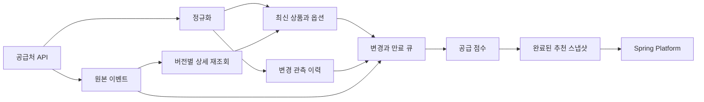

# 구조와 처리 정책

공급처별 수집기가 공통 상품 구조를 만들고 PostgreSQL에 저장한다. 통합 실행기는 수집과 상세 반영이 끝난 소싱처만 점수를 계산하고 발행한다. 현재 진척과 다음 작업은 [CONTEXT](CONTEXT.md)가 기준이다.

## 코드 책임

| 경로 | 책임 |
| --- | --- |
| `*_API/api/`, `naver_API/client.py` | 인증·HTTP·제공처 오류·호출 제한 |
| `*_API/services/`, `naver_API/services.py` | 응답 정규화·필드 의미·계산 |
| `*_API/workflows/`, `naver_API/collector.py` | 수집 범위·순회·재개 |
| `product_data_collector/domain/` | 최신 상태·옵션·이벤트·배송·점수의 순수 로직 |
| `product_data_collector/persistence/` | 트랜잭션·정합성·조회·DDL·점수 저장 |
| `product_data_collector/operations/` | 작업 순서·공동 API 예산·입력 보호·상태 |
| `scripts/` | 개발 보조 도구. 업무 규칙은 패키지에 둔다. |

저장 모듈은 [DATABASE](DATABASE.md#최신-상품), 재개·잠금 파일과 실험 산출물의 운영 규칙은 [RUNBOOK](RUNBOOK.md#로컬-자료-정리)에 있다.

## 데이터 흐름

쿠팡 베스트와 네이버 시즌 결과는 상품 점수와 별도의 일자별 스냅샷으로 발행한다. 서로 다른 날짜의 결과를 섞어 비교하지 않는다.

## 수집과 재개

| 공급처 | 최초 적재·발견 | 현재 일일 경로 |
| --- | --- | --- |
| 오너클랜 | `allItems` cursor 순회와 겹친 이력 재조정 | `itemHistories` 저장 후 `itemsByKeys` 최대 100개 묶음 상세 반영 |
| 도매매 | Private 도매매 상품 전체 순회 및 ES 상세, 완료 후 변경 검색으로 차이 반영 | Private 변경 검색 → ES 상세 → 관측 이력 누적 |
| 쿠팡 | 검토한 카테고리 목록 | 카테고리별 best 저장 후 날짜 전체 발행 |
| 네이버 | 검토한 월별 테마 | 광고 검색수 상위 10개와 트렌드 저장 후 날짜 전체 발행 |

원본 이벤트 저장, 상세 요청 버전, 상세 완료 버전을 구분한다. 페이지의 DB commit을 확인한 뒤에만 파일 checkpoint를 전진한다. commit 응답 유실과 checkpoint 저장 실패는 같은 범위를 다시 처리하며 자연키·fingerprint·관측 시각으로 중복과 역전을 막는다.

상세 worker는 상품별 lease와 요청 버전을 사용한다. 처리 중 새 요청이 생기면 이전 응답으로 새 버전을 완료하지 않는다. 목록에서 빠졌거나 상세가 미반환됐다는 이유만으로 상품을 삭제하지 않는다. 실행별 상태 파일과 잠금 이름은 운영 재개와 연결되므로 그대로 유지한다.

오너클랜은 한 번에 보낼 최대 100개만 claim하며, 다음 묶음을 미리 점유하지 않는다. 응답 key 전체를 검증한 뒤 상품마다 독립적으로 저장·완료한다. 같은 응답의 관측 시각은 모든 상품에 동일하게 적용한다. 이미 commit된 상품은 중단·재개 시 다시 수집하지 않고, 누락·저장 실패·처리 중 추가된 요청은 미완료로 유지한다. lease 시간에는 묶음·필드 fallback·누락 보완의 제한된 요청 예산을 포함하며, 만료되거나 교체된 token으로 새 소유자의 작업을 덮어쓰지 않는다.

**미반환과 수집 중단은 다르다.** 누락1회 보완 후에도 미반환이면 해당 상품만 실패/next_retry_at으로 남기고 다음 묶음을 계속 처리한다. 네트워크/HTTP/GraphQL 오류나 잘못된 응답의 예외는 현재 worker 실행을 중단할 수 있다. 전체 상세 시도 후 pending이 남아 완료 증표·새 점수/발행을 막는 것은 별도의 후속 단계 정책이다. 원본 서비스 기획은 매일 갱신을 요구하지만 개별 실패 시 부분 발행의 허용 여부까지 명시하지 않으며, 현재 Collector 설계는 이전 완료본 보존을 선택했다. 이를 “상품 하나 미반환이면 나머지 수집도 즉시 중단”으로 해석하지 않는다.

## 공급 점수

산식은 [domain/scoring.py](../product_data_collector/domain/scoring.py)의 `supply_v2`다. Decimal로 계산하고 최종 표시값만 ROUND_HALF_UP 정수로 반올림한다. 결측 항목은 가중치에서 제외하고 나머지를 환산한다.

| 항목 | 규칙 |
| --- | --- |
| 안정성 | 재고 20, 발송 25, 상품 품절 35, 공급가 변동 20 |
| 재고 점수 | 수량 1000/300/100/30/1/0 이상 → 100/80/60/40/20/0 |
| 도매매 발송 | 0.5/1/2일 이하 → 100/85/60, 초과 30. 빠른배송 +5, 상한 100 |
| 오너클랜 발송 | 1/2/3일 이하 → 100/75/50, 초과 25. 누락·1일 미만은 결측 |
| 90일 상품 품절 | 0/1/2/3회 이상 → 100/70/40/10 |
| 90일 공급가 변화 | 0/1/2/3회 이상 → 100/80/50/20 |
| 도매매 신뢰도 | 만족도×w + 70×(1−w), w=min(후기/50,1). 우수 +5, 간이·개인 −10, 0~100 제한 |
| 오너클랜 신뢰도 | 다른 상품의 품절 경험 비율 5/15/30/50% 이하 → 100/80/55/30, 초과 10. 표본 20개 미만은 70점으로 축소 보정 |
| 홈 점수 | 안정성 30, 신뢰도 25로 가중 평균. 한 값만 있으면 해당 값, 모두 결측이면 보류 |

9999는 충분한 재고로 계산하되 무한재고 표시를 별도 보존한다. 도매매 휴가 중 안정성 상한은 50이며 휴가 종료 날짜를 포함한다. 수익성·시장가·검색 트렌드는 공급 점수에 넣지 않는다.

### 90일 이력과 공급사 근거

품절 횟수는 `(as_of−90일, as_of]`와 겹치는 원본 상품 단위 `[soldout, restocked)` 구간 수다. 진행 중인 구간도 포함하고 연속 같은 상태 알림은 합친다. 옵션 품절·수량 변화·관측 스냅샷은 원본 구간 수에 더하지 않는다. 경계 상태 부재나 동시각 상충은 NULL과 사유로 남긴다. 종료 시각+90일이 만료 경계이며 진행 중인 구간은 시작+90일에 없애지 않는다.

가격은 인증된 `source_supply_v1` 또는 `observed_supply_v1` 중 하나만 사용한다. 원본 stream은 검증된 상품 공급가의 실제 전후 차이, 관측 stream은 anchor와 후속 유효 관측의 차이를 센다. 옵션 선택·불확실한 대표가격·범위 전환은 연결을 끊는다. 첫 관측만 있으면 0회 대신 NULL이며, 같은 가격의 두 번째 유효 관측으로 계산 가능해지는 전환도 큐에 넣는다.

`scoring_coverage`는 기간 완전성·공백·지연 도착과 경계 상태를 증명하는 검토된 근거다. API 순회 완료로 자동 인증하지 않는다. 공급사 신뢰도에는 `scoring_supplier_identity`의 vendorKey·현재 소속·카탈로그 근거도 필요하다. 검증된 다른 상품만 분모로 삼고 최대 1000개를 사용한다. MD5 순의 결정적 표본 1001개를 저장한 뒤 분석 상품을 제외한다. 관측 품절은 공급사 품절 경험의 근거가 될 수 있으나 상품 원본 사건 수로 바꾸지 않는다.

### 증분과 발행

초기 계산은 high_id와 keyset, 증분은 변경 큐·공급사 영향 큐·next_due 인덱스로 순회한다. 매일 전 상품을 다시 계산하지 않는다. 점수 저장·generation 확인 후 큐 삭제·run checkpoint는 청크 트랜잭션으로 처리한다. 기본 청크는 500, 허용 범위는 1~10000이다.

가격·표시 정보만 바뀌면 해당 상품을 갱신하고 불필요한 공급사 peer 계산은 피한다. 실제 품절·재입고, 품절 근거, 공급사 소속·인증 변경과 만료는 필요한 공급사 영향 확장을 유지한다. 전체 추천 발행은 유효 집합 전체를 읽고 정렬·저장하므로 증분 계산량과 별도의 비용이다.

증분 계산이 적거나 없어도 전체 추천 payload·순위와 인덱스의 발행 쓰기는 발생하며, 과거 배치 보존은 저장 공간을 누적 사용한다. 소규모 합성 조건의 쓰기/인덱스/FK/WAL·I/O는 계측했지만 목표 1,500만 상품의 처리시간·보관 용량은 미검증이다. 기존 planner/work_mem/CTE 정렬 대안은 채택하지 않았다. 비용 비교와 채택 결과는 [VALIDATION](VALIDATION.md#발행-쓰기-비용의-반복-비교), 우선순위는 [CONTEXT](CONTEXT.md#다음-작업-순서)를 따른다.

발행은 scoring_runs 행의 FOR UPDATE 잠금으로 직접 호출까지 직렬화한다. 완료 배치 재호출은 아무 행도 추가하지 않으며, 새 배치의 전체 행 삽입과 완료 표시는 한 transaction이다. 발행 행의 고유 인덱스/FK는 유지하고 행마다 수행하던 ON CONFLICT 무시 처리를 제거했다. 정상 rollback에서는 미완료 발행 행이 남지 않는다. 이미 영속화된 미완료 배치에 행이 있으면 입력/기존 payload를 섞어 완료하지 않고 `review batch integrity`로 중단한다. 이 상태는 삭제나 강제 완료 대신 별도 무결성 검토가 필요하다. 동점 순서·불변 payload·이전 정상본과 다른 소싱처 완료본은 보존한다.

## 통합 운영의 정합성

소싱처별 수집·상세 완료 후 `ops_collection_receipts`에 입력 revision을 기록한다. 계산은 해당 소싱처 입력을 보호하고 revision과 완료 증표를 확인한 뒤 고정 as-of로 처리한다. 같은 소싱처 writer는 계산 중 `55P03`으로 실패하고 다른 소싱처·조회는 별도로 진행할 수 있다. 단일 scoring session lock은 유지한다.

새 입력으로 revision이 달라지면 기존 미완료 run에 결과를 섞지 않는다. 같은 범위·시각은 재개하고, 범위가 달라지면 새 작업으로 교체한다. 미래 관측값, 남은 상세 요청, 미완료 큐가 있으면 발행을 거부한다. 발행은 원자적이며 이전 정상본과 과거 payload를 보존한다.

추천의 현재 기본 노출 조건은 판매 가능·대표 공급가 확정·홈 점수 존재이며 휴가 중 상품은 제외한다. 동점은 내부 product_id 오름차순이다. 이 정책과 운영 역할·보관 주기의 최종 합의는 운영 적용 과제다. 실행·공동 호출 예산·복구는 [RUNBOOK](RUNBOOK.md)을 따른다.
