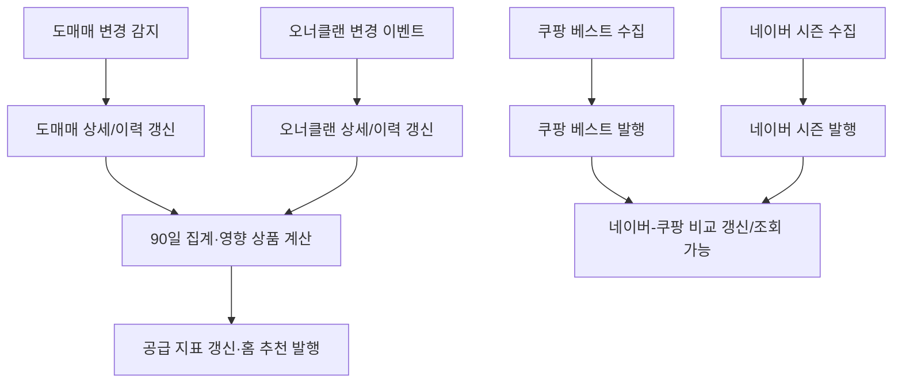

# Chozy 데이터 수집서버 설계서

> **버전:** 1.13 (2026-11-20, 오너클랜 history → 변경 상품 상세 최대100개 묶음 수집 방식 확정)
> **수정일:** 2026-11-20
> **대상:** `product-data-collector` — Python 데이터 수집·배치 서버
> **상태:** 1~9단계 유지, 10단계 공급사 영향 범위·SQL 왕복 최적화와 격리 회귀 완료(§19). 실제 운영·외부 인증·1,500만 상품 실측은 미완료다. 기존 구현과 당시 검증 기록은 §14~18에 보존한다.
> **범위:** Data Collector의 책임·배치·저장·운영 계약. Spring Platform 내부 구현의 상세 설계서는 별도.

> **v1.6 당시 재검토 기록(두 미해결 사항은 v1.7 §16.2/§17에서 해결):** v1.6 구조를 유지하고 §16에 일일 증분/90일 집계 정책 차이·재현된 수정 필요 사항·잠금/성능 검증 우선순위를 추가했다. 이 보완은 새 단계 구현이나 운영 적용 완료 선언이 아니다. 도매매 Private 동기화 API는 승인 대기다.

## 0. 기준 자료와 확인 표시

본 설계는 다음 문서와 2026-11-19 실제 API 검증 결과에 근거한다.

- **서비스 기획설명서:** `docs/specs/Chozy_서비스_기획설명서.pdf` (내부 v24-5, 2026-11-16). 서비스 요구사항·공급 점수·수집 주기의 기준.
- **API 명세서:** `docs/specs/API 명세서/API명세서/`의 개별 문서(API V10). Chozy Platform에 필요한 데이터·응답 형태의 기준. **내부 API 응답 예시는 외부 업체의 실제 API 응답이 아니다.**
- **최신 인수인계:** `Chozy_DataCollector_인수인계_최신반영_20261119.md` **1부**를 이전 개정에서 기준으로 삼았다. 이번 6단계 작업에서는 해당 파일을 발견하지 못해 직접 재대조하지 못했다. 도매매 Private 우선 방침 등 기존 유효 결정은 유지한다.
- **실제 API 검증 보고서:** `docs/experiments/API_FIELD_VERIFICATION_2026-11-19.md`와 증거 디렉터리, 기존 `API_PROBE_RESULTS.md`. 2026-11-19 및 과거 실측·타임아웃·필드 비교의 기준.
- **구현·검증 근거:** `docs/operations/STAGE1_SAFETY.md`~`STAGE6_NAVER.md`, 현재 소스와 `product_data_collector/persistence/{schema,stage2_schema,stage5_schema,stage6_schema,migrations}.py`. 단계별 테스트 기록은 §10에 구분한다.

**이번 개정의 확인 범위:** 기존 코드·DDL·테스트·기획/API V10·운영 문서를 대조하고 6단계를 구현한 뒤 단위/격리 PostgreSQL 및 1~5단계 전체 회귀를 실행했다. 운영 DB 스키마/적재량/적용 이력은 조회하거나 변경하지 않았고 외부 업무 API도 호출하지 않았다. 아래 구조는 **코드에 정의되고 격리 DB에서 검증된 구조**이며 운영 적용 완료 선언이 아니다. 전체 아키텍처와 후속 요구사항은 유지한다.

위 문단은 1.3 개정의 구현 기록이다. **1.4에서는 신규 단계나 점수를 구현하지 않고**, 기획서 §3.4·§6.6·§7·§9 및 §10.2, API V10, STAGE1~6, 실제 저장/조회/DDL/마이그레이션을 다시 대조했다. 검증 범위·결과·후속 계약은 §13을 따른다. 기존 단계 완료 기록은 유지하며 운영 DB 및 외부 API를 사용하지 않았다.

**확인 표시를 두 가지만 사용한다.**

- **실측 확인:** 실제 API 데이터 응답(이번 또는 명시된 기존 실측)에서 관찰되었거나, 응답값과 공식 설명이 함께 대조된 범위. **관찰된 상품·조회조건 외에 전 상품/전체 기간/향후 응답을 보장한다는 뜻은 아니다.**
- **미확정:** 표본 부족, 금번 타임아웃, 스키마/공식 문서에서만 확인, 권한 대기 또는 운영 정책 미결정. **응답에서 한 번 보이지 않았다는 이유로 API 전체에서 제공되지 않는다고 단정하지 않는다.**

이 표시는 **외부 API 필드·동작 확인 여부**에 사용한다. 이미 결정한 서버 역할·공유 DB·전체 최초 적재·변경분 갱신 등은 설계 요구사항으로 그대로 서술한다. 개발 제안은 '권장' 또는 '설계안'이라고 적되 별도 코드 표기는 달지 않는다.

**확정된 구성:** Python Collector가 공통 주기 수집과 공급 지표를 담당, Spring Platform은 사용자별 요청형 분석을 담당한다. 두 서버는 **하나의 PostgreSQL**을 공유하고, 도매매·오너클랜 상품을 최초 전체 적재한 뒤 신규·변경분 중심으로 갱신한다.

---

## 1. 목표와 제외 범위

### 1.1 목표

1. 도매매·오너클랜의 전체 위탁 상품을 **최초 1회 기준 상태로 적재**하고, 이후 신규 상품·변경된 상품 위주로 갱신한다.
2. 가능한 원본 **변경 이벤트**와 수집기가 관측한 **상태 스냅샷**을 분리 저장해 최근 90일 공급가·품절 이력과 현 상태를 제공한다.
3. 전체 상품의 공급 안정성·공급사 신뢰도를 계산해 **소싱처별** 홈 추천 순위를 갱신한다.
4. 공통 홈 데이터인 **쿠팡 카테고리별 베스트**와 **네이버 시즌 키워드**를 주기 수집한다.
5. 실패·중단·재실행에도 이력 누락, 최신값 역전, checkpoint 선행 기록, 기존 DB 파괴를 방지한다.
6. 수집된 결과를 공유 PostgreSQL에서 Spring Platform이 안정적으로 읽도록 제공한다.

### 1.2 책임 분리 — **호출 목적 기준**

| 기능 | Python Collector | Spring Platform |
|---|---|---|
| 도매매·오너클랜 전체 적재·변경 감지·원본 이력 | **담당** | 저장된 상품/이력 읽기, 필요 시 요청형 상세 조회 |
| 공급 지표(공급 안정성/공급사 신뢰도) 및 홈 공급 순위 | **공통 데이터 계산·발행** | 조회, 리포트에 재사용 및 사용자별 추가 계산 |
| 쿠팡 `bestcategories` 카테고리별 베스트 | **일일 배치** | 홈 API 응답 제공 |
| 쿠팡 `products/search` 시장가 | 공통 정기 전체상품 수집 **안 함** | 사용자 리포트·요청형·관심상품 갱신에서 사용 |
| 네이버 검색광고 `RelKwdStat`, 검색 트렌드 | **공통 시즌 홈 데이터 일일 배치** | 스크리닝·리포트·관심상품별 요청형/주간 분석 |
| 관심상품 공급 조건·알림·시장가·트렌드 | 원재료(상품/이력/공급 점수) 제공 | **사용자별 재계산·알림·주간 갱신 담당** |
| 회원·인증·리포트 생성·차감·개인 데이터 | 제외 | **담당** |
| Wing, KIPRIS, LLM, Estimate 등의 리포트 요청형 처리 | 원칙적으로 제외 | 필요 시 담당 |

**중요:** 같은 제공사의 API를 양쪽 서버가 사용해도 된다. 구분 기준은 **정기·공통·비사용자별 = Collector**, **요청형·사용자별 = Platform**이다. 공유 자격증명/계정 한도가 있으면 서버별로 독립 카운터를 돌려서는 안 되며 **합산 예산**이 필요하다. 주간 관심상품 갱신은 기획서상 주기적 작업이지만 **사용자별 비즈니스 로직**이므로 Platform이 담당한다. 다만 향후 주간 시장 데이터의 순수 수집을 Collector로 위임하려면 별도 변경 결정이 필요하다.

### 1.3 비기능 목표

- 약 **1,500만 상품** 규모를 염두에 두되 실제 적재 수·변경률은 운영 측정값으로 갱신한다.
- **정합성 > 단순 처리속도:** 완결되지 않은 구간을 완료 처리하지 않음.
- 운영 중 일반 수집 작업에서 파괴적 DDL 금지. 마이그레이션은 명시적·추가형.
- 공식 API만 사용. 화면 크롤링, 여러 키로 호출 한도 우회 금지.
- 외부 미확정 필드·호출 한도를 성공적으로 검증했다고 주장하지 않음.

---

## 2. 전체 아키텍처

```mermaid
flowchart TB
    subgraph APIs[외부 공식 API]
      D[도매매 Open / Private]
      O[오너클랜 Seller GraphQL]
      C[쿠팡 파트너스]
      N1[네이버 검색광고]
      N2[네이버 API HUB 검색 트렌드]
    end
    subgraph Collector[Python Data Collector]
      S[배치 진입점 / 스케줄 관리]
      Q[API별 호출 예산 / 재시도 / 일시정지]
      W1[초기 적재 · 신규 발견 · 증분 동기화]
      W2[쿠팡 베스트 · 네이버 시즌]
      E[정규화 · 원본 이벤트/스냅샷]
      SC[공급 지표 · 홈 순위 생성]
      ST[배치 실행 기록 · 체크포인트]
    end
    subgraph DB[(공유 PostgreSQL)]
      P[(상품 · 옵션 · 원본 이벤트 · 관측 이력)]
      H[(홈 베스트 · 시즌 · 공급 점수 · 발행 순위)]
      J[(수집 실행 · 재개 상태)]
      U[(회원 · 리포트 · 관심 · 알림 등)]
      B[(API 호출 예산/캐시 — 구현 계약 협의)]
    end
    PL[Spring Platform: 홈 조회 · 사용자별 분석 · 알림 · 실시간 외부 API]
    D --> Q
    O --> Q
    C --> Q
    N1 --> Q
    N2 --> Q
    S --> W1 & W2 & SC
    Q --> W1 & W2
    W1 --> E --> P
    W2 --> H
    SC --> P
    SC --> H
    S --> ST --> J
    PL --> P & H & U & B
    Q -. 공유 호출 예산 .-> B
```

**그림 해석:** Spring이 수집기 REST API를 경유해야 한다는 뜻이 아니다. **현재 확정은 PostgreSQL 공유**이며, Collector 내부 REST API·메시지 브로커는 필수가 아니다. `API 호출 예산/캐시`의 구체 구현(DB, Redis 등)은 아직 확정되지 않았으므로 위 노드는 **논리적 공유 계약**이다.

### 2.1 공유 DB의 쓰기 책임

| 데이터 도메인 | 주 쓰기 담당 | 읽기 담당 | 주의 |
|---|---|---|---|
| `products`, `product_options`, `product_events`, `product_history` | Collector | Platform | Platform 요청형 상세 갱신을 이 테이블에 기록할지 **추가 합의 필요**. 무단 이중 writer 금지 |
| `product_discovery_targets`, 수집 checkpoint/실행 기록 | Collector | 운영 도구 | 배치 재개·중복 실행 제어 |
| 공급 점수·홈 공급 추천·쿠팡 베스트·시즌 데이터 | Collector | Platform | **완료된 배치만 발행**, 조회 중 부분 결과 노출 금지 |
| 회원·권한·리포트·관심상품·개인 알림 | Platform | Platform | Collector가 수정하지 않음 |
| 외부 API 공통 캐시·계정 호출 예산 | 양 서버가 공유 계약 준수 | 양 서버 | 소유·동시성·우선순위 구현은 확정 필요 |

공유 DB라도 **하나의 테이블을 두 서버가 같은 규칙 없이 UPDATE하는 구조는 피한다**. 요청형 플랫폼 조회로 최신 상품을 갱신할 필요가 생기면 (A) Platform은 별도 캐시에 쓰고 Collector만 공통 마스터를 수정하거나, (B) 공통 저장 서비스/저장 계약을 만들도록 명시적으로 결정한다. 현재 기본은 A를 권고한다.

---

## 3. 수집 대상 및 실행 계약

| 수집 작업 | 외부 API/데이터 | 구동 시점 | 산출물 |
| --- | --- | --- | --- |
| 도매매 최초 적재 | 카테고리/목록 + `getItemView(market=supply)` 등 기존 discovery 경로 | 최초·재적재·누락 복구 | 상품/옵션/기준 스냅샷 |
| 도매매 변경 감지 | **Private 동기화** `POST /api/v1/product/_search` 우선 | 일일 변경 수집 | 변경 대상 및 검증 가능한 원본 신호 |
| 도매매 변경 상세 | 승인된 상세 조회, 필요 시 `getItemView(market=supply)` | 변경·신규·재검증 대상 | 최신 공급가·재고·옵션·배송 조건 |
| 오너클랜 최초 적재 | Seller GraphQL `allItems` | 최초·복구 | 상품/옵션/공급사 관계·초기 스냅샷 |
| 오너클랜 변경 감지 | `itemHistories` | 일일·겹침 구간 재조회 | 발생 이벤트 및 변경 대상 |
| 오너클랜 최신 상세 | `itemsByKeys(keys:[...])` 최대100개; `item(key)`는 개별 진단·보완 | 이력에서 확인한 고유 변경 상품 | 최신 상태/옵션; 업무 묶음 전환은 후속 구현(§23) |
| 신규 상품 discovery | 도매매 목록, 오너클랜 `allItems`의 신규 탐색 경로 | 별도 배치/예산 | 신규 상품 후보 및 적재 |
| 쿠팡 베스트 | `/products/bestcategories/{categoryId}` | 매일 | 분야별 순위 스냅샷/전일 비교 |
| 네이버 시즌 | 검색광고 `RelKwdStat(event,month)` + 데이터랩 검색 트렌드 | 하루 1회 | 테마 3개 내 상위 10개 키워드, 월간 검색수, 최근 4주 상승률 |
| 공급 점수·홈 순위 | 기존 PostgreSQL 상태·90일 이벤트 | 초기 전체 + 일일 영향분 | 공급 안정성/신뢰도 및 소싱처별 순위 |
| 네이버·쿠팡 비교 | 앞서 적재한 시즌 키워드·쿠팡 베스트 | 배치 후 계산 또는 조회 시 DB 계산 | 키워드 일치/불일치 결과 |


**주기 구분:** 기획서의 "매일"·"하루 1번"은 확정이나 **몇 시 몇 분**은 확정되지 않았다. API 명세서 예시의 `03:00`을 스케줄 확정값으로 복사하지 않는다. 모든 기준일·수집 완료 시각은 `Asia/Seoul` 해석을 명시하고 내부 저장은 offset 포함 시각을 권장한다.

### 3.1 초기 적재 ↔ 증분 전환

1. 수집 **시작 전/시점 부근의 안전한 변경 조회 워터마크**를 기록한다.
2. 전체 수집을 페이지/카테고리/구간 단위로 진행하고, 성공적으로 DB commit된 범위만 checkpoint 완료한다.
3. **초기 적재 중 변경 이벤트 수집도 허용**한다. 단순히 초기 적재가 끝날 때까지 이벤트 적재를 연기하지 않는다.
4. 최초 적재와 증분 구간을 **겹쳐 조회**, 중복 제거 후 최신 관측 기준으로 병합한다.
5. 소스별 총량·완료 범위·실패 범위·해당 날짜 이후 갱신을 대조한 다음 일일 정상 운영으로 전환한다.
6. 누락 상품, 신규 발견, 백필, 재처리는 서로 다른 job으로 관리한다. 최초 스냅샷을 가격 변경 이벤트 1건으로 세지 않는다. 조회 API가 제공하는 시간 조건·페이지/커서의 완결성 보장이 불충분하면 **100% 무누락을 단정할 수 없다**. 운영상 정기 reconciliation 경로를 둔다.

### 3.2 도매매 데이터 파이프라인

```text
Private 동기화 API 변경 대상 조회
 -> 변경 목록·검증 가능한 이벤트 키 저장
 -> 상세 재조회가 필요한 대상 선별
 -> getItemView(market=supply) 등 승인된 상세 API 조회
 -> 원본 필드 검증/정규화(도매매 공급가 채널)
 -> products / product_options 최신 상태 갱신
 -> product_history 관측 상태 비교 기록
 -> product_events 검증 가능한 원본 신호 별도 저장
 -> 영향 상품 공급 점수 갱신 후보 등록
 -> 완료 구간 checkpoint commit
```

위 흐름 중 공급 점수 재계산은 7단계 설계 목표다. **4단계 구현 완료 범위**는 기존 카테고리/목록 bootstrap·discovery·recovery와 Private 증분 조회, 상세·관측·원본 신호 저장, checkpoint·예산·잠금이다. `domeggook_API/workflows/stage4.py`와 `stage4_cli.py`, `api/private_sync.py`가 진입점/연동 계약이며 별도 DB 스키마는 추가하지 않았다.

Private 요청은 공식 문서 기반 Bearer 인증, `channel.supply=true`, 고정 `dateModify` 구간, `search_after`/`searchAfter` 배열을 구현했다. **실제 성공 응답 검증은 미완료**다. 제공사 시간대는 명시 설정하고 checkpoint에 고정한다. 기본 60초 겹침은 구현 설정일 뿐 지연 도착의 실측 보장이 아니다. 카테고리·페이지/조회 구간·커서를 보존하고 상세·신호를 같은 DB 트랜잭션에 저장한 뒤 파일 checkpoint를 진행한다.

Private 결과는 내부 분류 `modification_signal`로 저장하며 실제 API 이벤트 enum으로 해석하지 않는다. `dateModify`는 원문에 보존하되 사건 발생 시각으로 사용하지 않아 `occurred_at=NULL`이다. 원본 전체 fingerprint로 중복을 막지만 동일 상태로 돌아온 별개 변경은 구분하지 못할 수 있다. bootstrap의 completed는 목록 스캔 완료이며, `incrementalCatchupRequired`/`syncRequiredFrom`에 따라 별도 catch-up이 필요하다. 승인 대기로 실행하지 못한 기간과 `channel.supply` 이탈/삭제 상품의 누락 가능성은 미확인으로 남긴다.

- **최신 실행 결정:** 동기화 API를 변경 감지 주 경로로 개발한다. 이전 인수인계 2부의 `getAllSupplyChk` 우선 권고는 적용하지 않는다.
- **접근 상태:** 2026-11-18 확인 시 `승인되지 않은 APIKEY`; 승인 신청 중이며 **허가·실제 성공 응답 미확인**. 승인 전에는 fixture/mock 기반으로 구현·테스트하고 승인 후 필드, 페이지/커서, 날짜 조건, 제한, 변경 이벤트 범위 검증.
- `getAllSupplyChk`는 비교·누락 점검·대체 경로 후보이나 **허락 없이 운영 기본 경로로 자동 전환하지 않는다**.
- 동기화 API가 **가격·재고·옵션·품절·배송비·판매상태를 전부 포착한다는 보장은 없다**. 상세에 가격/옵션 필드가 모자라면 재조회하고, 누락된 이벤트를 만들어 내지 않는다.
- `getAllSupplyChk`의 `AMT`는 **가격 변경 횟수와 동일하다고 단정 금지**. `OPEN`은 신규 등록/재입고와 구분, `SOLDOUT`/`RESTART`도 원본 신호와 현재 상품 상태를 구분한다.
- **실측 확인:** `getItemView(market=supply)`의 `price.supply`는 도매매 기본 공급가, `selectOpt`의 `data[*].supPrice`는 도매매 시장의 **옵션 추가금**이다(상품 응답 + 상세 API 공식 첨부 설명 대조). **검증된 고정단가·조합형**에 한해 `옵션 최종 공급가 = price.supply + supPrice`로 계산한다. `domPrice`는 도매꾹 시장 추가금이므로 혼용하지 않는다. 추가금 `0`은 정상값이다.
- **실측 확인:** `selectOpt`는 JSON 문자열 또는 null이며, 내부 `data`는 숫자 인덱스 **맵(map)**이고 `set`/`orgSet`은 배열이다. 옵션의 `qty`, `hid`, `sup` 등을 보존한다. `hid=1`은 판매 종료로 **재고가 양수여도 판매 가능으로 판단하지 않는다**. `hid=2`의 실제 응답은 이번 표본에서 관측되지 않았고, 의미는 공식 계약을 따라 처리한다.
- **미확정:** 독립형/차등단가/음수 추가금/할인 전후 가격 조합에서 위 최종가 산식을 일괄 적용할 수 있는지, `data` 키와 `hash`를 변경 후에도 영속 옵션 ID로 사용할 수 있는지. 특히 `hash`는 옵션명·추가금 변화로 바뀔 수 있으므로 영속 ID로 단정하지 않는다.
- 배송비는 `deli.supply.fee` **고정값뿐 아니라** `deli.supply.tbl`의 수량별비례 규칙이 존재한다. **실측 확인.** `fee` 숫자 하나만으로 배송비 규칙을 대체하지 않는다.
- **실측 확인:** 일반 `getItemView` 응답에 `seller.score.avg`(예: `"95%"`)와 `cnt`(숫자)가 있고, 동일 상품 표본의 Private `getItemViewES`에서는 `seller.score`가 관측되지 않았다. 공급사 신뢰도에 필요한 만족도는 **일반 상세에서 확보**하고 `cnt=0`·평가 없음은 0점과 구분한다. ES만으로 완전 대체한다고 가정하지 않는다.

### 3.3 오너클랜 데이터 파이프라인

```text
itemHistories(구간/cursor) -> source 이벤트 정규화/중복 방지 저장
 -> 변경 상품 itemKey 중복 제거 및 상세 재조회 요청 버전 저장
 -> itemsByKeys(keys:[...])로 최대100개씩 최신 상세 조회
 -> 요청/반환 key 대조 및 미반환 key만 제한 보완 조회
 -> products/options 최신 상태와 관측 스냅샷 갱신
 -> 공급사 단위 영향 상품까지 점수 재계산 큐 확장
 -> 완료 범위 checkpoint 기록
```

위 흐름은 2026-11-20 확정 설계다. 현재 업무 `refresh_details`는 `item(key)` 단건이며, 100개 묶음 전환은 후속 구현 대상이다. 묶음 API의 실측은 §22, 확정 운영/부분 성공 계약은 §23을 따른다. 원본 피드 순회 완료와 상세 반영 완료는 별도로 기록한다.

**3단계 구현 완료 범위:** bootstrap은 시작 watermark와 페이지별 변경 피드/최종 overlap을 병행하고, daily는 `itemHistories` 중심으로 이벤트 및 상세 재조회 요청을 저장한다. discovery/recovery/backfill은 별도 상태를 사용한다. `stockChanged`/`optionStockChanged`는 원본 이벤트로 적재하지 않고 현재 상태 재조회만 요청한다. 이벤트 수집 완료와 상세 반영 완료를 분리하고 기존 버전별 요청/lease 큐를 재사용한다. 연속 이력 커버리지·제공처 보존기간 밖 복구는 보장하지 않으며, 위 공급사 영향분 점수 큐 확장은 7단계 목표다.

- `itemHistories`의 가격 증가/감소, 품절/재입고, 유통금지, 반품배송비 변경, 옵션 상태/가격/구성 변경 등의 **검증된 원본 enum**을 보존. 정확한 enum 예시는 인수인계 1부 §C.3 참조.
- `stockChanged`, `optionStockChanged`는 기획대로 **수량 이벤트 이력에서 제외**하고 현재 재고값은 최신 상태로 관리한다. 품절 판단을 `quantity=0`만으로 대체하지 않는다.
- **실측 확인:** 오너클랜 이력 `createdAt`은 Unix **밀리초**, 도매매 `getAllSupplyChk` `date`는 Unix **초**이다. 단위를 혼동하지 않는다.
- **실측 확인:** 현재 `ItemHistory` 스키마의 전체 필드는 `itemKey`, `kind`, `title`, `valueBefore`, `valueAfter`, `createdAt` **6개**뿐이다. `optionKey`, `optionId`, 고유 event ID가 없다. **옵션 미식별 이벤트는 unresolved 상태로 원본 유지**, 옵션명이나 커서만으로 현재 옵션 ID에 자동 연결하지 않는다.
- **미확정:** 2026-11-19 실제 `allItems`·`item`·`itemHistories` 조회는 모두 ReadTimeout이었다(인증 및 introspection은 성공). 기존 응답에는 일부 상품·옵션 데이터가 있지만, `metadata.vendorKey`의 실제 공급사 식별 가능 여부, `options.status`, `options.fixedPrice`의 실제 값/의미와 커서·날짜 필터 동작은 추가 검증이 필요하다. `options.status`는 스키마상 존재하지만 현재 선택 쿼리에서 누락된다.
- **실측 확인:** 현 GraphQL 스키마의 `Item`에 직접적인 `vendorKey`/`supplier` 필드는 없다. `metadata` JSON 내부의 `vendorKey` 제공 여부는 **미확정**이다. null인 서로 다른 상품을 하나의 공급사로 묶으면 안 된다.
- 공급사 평판의 공식 지표가 없는 오너클랜은 공급사 품절 비율로 별도 신뢰도 산식 적용. 출처 간 신뢰도 점수 산식이 달라 홈 순위도 **각각 분리**.
- `items(keys:[...])`와 `itemsByKeys(keys:[...])`는 다른 이름이다. 후자는 §22에서 실제 production100개 묶음 조회를 확인했다. 공식 문서의5,000개와 달리 이 서버는 최대100개 오류를 반환하므로 검증된100개 기준으로 상세 호출량을 계산한다.

### 3.4 쿠팡 베스트

1. **실측 확인:** `/products/bestcategories/{categoryId}` 호출 성공. `categoryId=1010`은 이번 응답에서 **뷰티** 카테고리이며, `limit=100`으로 호출해 **81개**가 반환됐다. 100개 고정 반환이라고 가정하지 않는다.
2. **실측 확인:** 본문 `$.data`는 배열이고 `productId`(정수, 일부 32비트 초과), `productName`, `productPrice`(실수 형태 가능), `rank`(1~81), `isRocket`(boolean), `productImage`, `productUrl`, `categoryName`, `keyword`가 실제로 반환됐다. HTTP 200뿐 아니라 응답의 `rCode` 성공값도 확인한다.
3. **실측 확인:** 표본 81개에서 `rank`는 배열 순서와 같지만, 순위는 **응답 `rank`를 직접 저장**한다. `categoryId`는 각 상품 본문에 없으므로 **요청 경로에서 보존**한다.
4. 카테고리별로 **기준일·수집일·요청 카테고리·상품 ID·순위·가격·로켓배송·발행 버전**을 기록하고, 완결성 검증 후 완료 배치로 발행한다.
5. 이전 날짜 같은 카테고리의 **완료된 스냅샷**과 비교해 `UP`, `DOWN`, `SAME`, `NEW`를 계산한다. 전일 데이터가 없거나 실패한 경우 모두 `NEW`로 오인하지 않는다.
6. `/home/keywords/coupang`은 Platform이 완료된 DB 스냅샷을 조회해 API V10 형식으로 반환한다.

- **미확정:** 카테고리 1010 이외의 실제 운영 대상 카테고리 목록, 모든 카테고리에서의 반환 수/필드 완전성, 계정별 RPM과 날짜별 순위 누락 정책.
- **실측 확인:** `products/search`는 기존 실응답에서 주요 필드를 확인했다. 그러나 **search는 `$.data.productData`**, best는 **`$.data`**로 응답 래핑이 다르므로 파서를 구별한다. Collector 전체 상품 시장가 일일 조회로 확장하지 않는다.

**5단계 구현 완료:** 기존 인증·HTTP client·RateLimiter를 재사용하고 best 전용 파서·일별 저장·독립 CLI를 추가했다. 실제 `rank`, 요청 category_id, 상품 원문 및 정규화 가격/로켓/URL/이미지를 저장한다. 100개 미만 정상 배열을 허용하며 빈 배열은 정상 의미가 미검증이므로 실패 처리한다. 이것은 모든 카테고리의 외부 응답 완전성이 확인됐다는 뜻이 아니다.

- 기준일별 category ID/설정 이름/limit scope를 고정한다. 카테고리 상품과 완료 checkpoint를 같은 DB 트랜잭션으로 저장하고 pending만 재개한다. 전체 카테고리 상태·실제 행 수를 검증한 뒤 비교값과 완료 발행 시각을 원자적으로 commit한다.
- 비교 기준은 **정확히 전일**, 동일 category, 배치까지 completed인 스냅샷이다. `rankChange=previousRank-rank`; 전일이 유효한데 상품만 없을 때 NEW다. 전일 부재/실패/부분 수집은 비교 필드 모두 NULL, `comparison_status=previous_unavailable`이다. 더 오래된 날짜로 대체하거나 늦게 도착한 전일로 이미 발행한 비교값을 소급 변경하지 않는다.
- 운영 category 목록·`max_calls`·`requests_per_minute`는 명시 설정한다. 날짜별 DB 누적 호출 예약은 요청 전에 commit하며 재실행에도 유지한다. 예약 후 중단은 보수적으로 소비한다. best HTTP 자동 retry는 없으며 403/429/본문·네트워크 오류 시 중단한다. 이 예산은 Platform과 공유하는 계정 quota가 아니다.
- `python -m coupang_API --config <검토한 설정> --dsn-env <DSN 환경변수명>`은 오프라인 계획이며 `--execute`가 있어야 실제 호출한다. 기존 검색은 `--mode legacy-search`로 보존했다. 기존 일일 scripts는 여전히 과거 검색 함수를 호출하므로 베스트용으로 사용하지 않으며 8단계에서 통합한다.
- 5단계 구현 중 외부 API를 새로 호출하지 않았다. 기존 1010/81개 실측과 mock/격리 DB 검증을 구분한다. 저장/조회 계약은 §4/8, 운영 절차는 `STAGE5_COUPANG.md`를 따른다.

### 3.5 네이버 시즌 키워드

1. 운영 설정에서 상품 관련 시즌 테마 **3개**를 정한다. 테마 코드/월을 소스 호출 기록에 보존한다. 실제 운영 테마 선정은 별도 결정한다.
2. **실측 확인:** 검색광고 `GET /keywordstool`에 `event=6`, `month=11` 또는 `12`를 보내면 힌트 키워드 없이 각 **1,200개**가 반환됐다. 응답 배열은 `$.keywordList[*]`, 키워드는 `relKeyword`, 검색수는 `monthlyPcQcCnt`/`monthlyMobileQcCnt`이다.
3. **실측 확인:** 검색수는 `integer`와 `"< 10"` 형태 문자열이 혼재한다. 소량값은 **공백 제거 후 `<10`으로 판정**해야 한다. PC·모바일 중 하나라도 소량값이면 월간 검색수의 정확한 합계를 알 수 없으므로 0/5/9로 치환하지 않고 기획의 소량 키워드 제외 규칙을 적용한다. 숫자 `10`은 소량 문자열이 아니다.
4. 월간 PC+모바일 검색수로 내림차순 정렬해 상위 **10개**를 선정한다. 데이터가 누락되었거나 둘 중 일부가 소량 문자열인 항목은 정확한 합계로 순위를 매기지 않는다.
5. **실측 확인:** 네이버 API HUB `POST /search-trend/v1/search`에 `timeUnit="date"`, `keywordGroups` 5개, 56일 범위를 넣으면 `$.results[*].data[*].period/ratio`가 반환됐다(5그룹 각 56일). `ratio`는 **0~100 상대지수**이며 검색 건수가 아니다.
6. 상위 10개를 5개씩 **2회** 요청. 상승률 `% = (최근 28일 평균 / 이전 28일 평균 - 1) × 100`을 **같은 요청의 같은 키워드** 안에서 계산한다. 이전 평균 0·일자 누락·응답 없음이면 `null`로 처리한다.
7. `/home/keywords/naver`은 완료 스냅샷 반환. `/home/keywords/compare`는 같은 기준의 시즌 키워드와 **실제로 수집한** 쿠팡 베스트 범위 안에서 상품명의 공백 제거 포함 여부를 비교하고 적용 범위를 밝힌다.

**인증:** 검색광고와 네이버 API HUB 자격증명/호스트/헤더는 별개다. 서로 다른 요청의 `ratio` 절대값을 비교·연결해서는 안 된다.

**6단계 구현 완료:** `naver_API`의 독립 CLI/client/services/store/queries가 위 흐름을 담당한다. `season.example.yaml`은 예제이며 운영 YAML의 YYYY-MM별 3개 event/name/month를 명시한다. 해당 월 설정이 없으면 실패한다. `python -m naver_API --config <설정> --dsn-env <DSN 환경변수명>`은 오프라인 계획이고 `--execute`에서만 실제 수집한다. `.env` 자동 로딩과 기존 scripts 연결은 없다.

- D-56~D-1 완결 일자를 요청하고 그룹 title/keywords/기간을 검증한다. 날짜 누락/중복/범위 밖/비정상 ratio, 그룹 부재, 이전평균 0은 사유와 NULL 상승률을 보존한다. API 자체 오류·잘못된 기간/그룹 매핑은 실패다. 동률은 keyword 문자열 순이며 정확한 후보 10개 미만은 실패한다. 이는 API V10의 최대 10개보다 보수적인 발행 정책이다.
- 광고 원문 전체(제외한 소량값 포함), 트렌드 요청 그룹/응답 일별 ratio, 실제 observed_at, 기준일/대상 월/계산 버전 mean28_v1을 저장한다. 성공 요청마다 데이터와 DB checkpoint를 함께 commit하고 미완료 요청만 재개한다. 3테마×10개/9요청을 검증한 후 일별 배치를 원자 발행한다.
- HTTP 예약은 실제 DB KST 호출일 기준 광고/트렌드 일 예산과 트렌드 월 예산을 분리해 요청 전에 commit한다. 과거 기준일 재실행도 같은 호출일 예산을 공유한다. 실패/crash 예약도 소비하며 재실행으로 초기화하지 않는다. Collector 공통 session lock 및 API별 간격을 사용하고 HTTP 자동 retry/redirect는 없다. 429=paused, timeout/인증/응답 오류=failed다. Platform 공동 quota는 아직 미구현이다.
- 비교는 조회 시 동일 기준일에 발행 완료된 쿠팡의 실제 수집 카테고리만 대상으로 한다. 공백 제거 포함 검사 후 DISTINCT product_id를 센다. 쿠팡 부재/부분 실패/다른 날짜는 comparisonStatus=coupang_unavailable이며 불일치로 분류하지 않는다. 상세 조회 계약은 §8, 운영은 `STAGE6_NAVER.md`를 따른다. 이번 구현에서 새 외부 API 실측은 하지 않았다.

- **미확정:** 운영에 사용할 월별 테마 코드/구성, 소량값과 일부 누락이 많은 예외 상황의 추가 처리 방식, 전체 사용자 트래픽에 대한 실제 한도 여유. 실측은 응답 형태와 산식 성립을 확인한 것이며 대량 운영 가능성을 보장한 것은 아니다.

### 3.6 API별 핵심 필드 확인 요약

| API / 항목 | 실제 확인한 필드 또는 동작 | 확인 상태 |
|---|---|---|
| 도매매 `getItemList` | `list.item[*].no/title/id/price`, 페이지 정보, `market.supply` 문자열 | **실측 확인** |
| 도매매 `getCategoryList` | `items` 및 재귀 `child`가 동적 키의 **map**, `code/name` | **실측 확인** |
| 도매매 `getItemView` | `basis.status/dateReg`, `price.supply`, `qty.inventory`, `deli.supply`, `seller.score` | **실측 확인** (표본 5상품) |
| 도매매 옵션 조합형 | `selectOpt` JSON 문자열, `data[*].supPrice` 추가금, `hid`, `qty` | **실측 확인** (조합형·고정단가 범위) |
| 도매매 옵션 다른 유형 | 독립형·차등단가·음수 추가금·옵션 ID 영속성 | **미확정** |
| 도매매 `getAllSupplyChk` | `items.item[*].no/status/date/price/qty`, 9종 status, 날짜/페이지 | **실측 확인** (기존 실응답) |
| 도매매 Private `getItemViewES` | 상세 구조와 옵션 필드; `seller.score`는 동일 상품 표본에서 미관측 | **실측 확인** (제한된 표본) |
| 도매매 Private 동기화 `_search` | 변경 탐지 범위·조회조건·응답/한도 | **미확정** (승인 대기·성공 실응답 미검증. 문서 기반 client/fixture·격리 DB 테스트 구현 완료와 구분) |
| 오너클랜 `itemHistories` | 기존 실응답의 `kind/valueBefore/valueAfter/createdAt`; 스키마상 option ID 없음 | **실측 확인** (기존 실응답·현 스키마) |
| 오너클랜 최신 상품 조회 | `metadata.vendorKey` 실제 값, `options.status/fixedPrice`, 날짜 필터·커서 동작 | **미확정** (이번 데이터 조회 타임아웃) |
| 쿠팡 `bestcategories` | `$.data[*].productId/productPrice/rank/isRocket` 등, 1010 뷰티 81개 | **실측 확인** |
| 쿠팡 운영 전체 카테고리·RPM | 전체 대상 카테고리 코드와 호출 한도 | **미확정** |
| 네이버 검색광고 `RelKwdStat` | `keywordList[*]`, `relKeyword`, 기기별 월간 검색량, `< 10` 문자열 | **실측 확인** |
| 네이버 API HUB 트렌드 | `results[*].data[*].period/ratio`, 5그룹 × 56일 | **실측 확인** |

---

## 4. 데이터 모델과 데이터 품질

### 4.1 현재 구현 구조와 운영 적용 경계

| 테이블/영역 | 의미 | 상태 |
|---|---|---|
| `products` | `(platform, external_product_id)`별 최신 마스터; 공급가·재고·배송·관측 watermark 포함 | **구현·격리 DB 검증 완료**. 오래된/동일 시각 관측으로 최신 상태를 덮어쓰지 않음 |
| `product_history` | 수집기가 관측한 상태 변경 **스냅샷** | 기존 유지/보존. 원본 API 이벤트로 재해석 금지 |
| `product_events` | source/observation 구분, nullable 발생 시각, 전후 값/원문/검증 상태, dedupe_key | **2~4단계 구현·격리 DB 검증 완료**. Ownerclan 원본 종류 및 Private modification_signal 경로 구현; 외부 완전성은 미검증 |
| `product_options` | `(product_id, option_identity)` 고유키, 원본 참조/가격/재고/상태/해석 신뢰도/관측·membership 시각 | **구현·격리 DB 검증 완료**. 도매매 검증된 조합형 가격·hid/sup/수량 상태를 반영; 영속 ID와 다른 유형 산식은 미확정 |
| `product_discovery_targets` | discovery·상세 요청/완료 버전, retry/lease | **2~3단계 구현·격리 DB 검증 완료**. 이벤트 감지 완료와 상세 완료를 분리 |
| `product_search_ranks` | 키워드/카테고리/market/sort 문맥별 검색 순위 | 기존 데이터·고유키 보존. 쿠팡 베스트 일별 가격/발행 데이터로 재해석하지 않음 |
| `product_raw_samples` | 원본 진단 표본 | 기존 데이터 보존, 보존 상한과 신규 샘플 예산 분리 |
| `storage_backfill_progress` | 이름별 high/last product ID, 처리 수/완료 여부 | 2단계 keyset 백필 진행을 DB 갱신과 함께 commit |
| `schema_migrations` | 추가형 migration 기록 | 명시적 migration CLI. 일반 수집에서 기존 스키마 자동 ALTER/데이터 삭제 금지 |
| `coupang_best_batches` | snapshot_date PK, 고정 scope, 실행 상태, 누적 호출 예약, 시작/발행 시각 | **5단계 구현·격리 DB 검증 완료**. 날짜가 불변 일별 발행 버전 |
| `coupang_best_categories` | `(snapshot_date, category_id)` PK, 설정 이름, 완료 상태/상품 수/observed_at/비교 상태/응답 메타데이터 | 상품 저장과 같은 트랜잭션의 DB checkpoint |
| `coupang_best_items` | `(snapshot_date, category_id, product_id)` PK, 같은 날짜/category/rank UNIQUE | BIGINT ID, NUMERIC(18,2) 가격, 실제 rank/로켓/URL/이미지/raw와 전일 비교 |
| `coupang_best_published` (view) | 배치와 category가 모두 completed인 상품 | 미완료 결과 제외. 읽을 때 하나의 완료 snapshot_date로 고정 |
| `naver_season_batches` | snapshot_date PK, 고정 scope, 56일 period_start/end, 상태·시작/발행 시각·오류 종류 | 6단계 일별 발행 경계 |
| `naver_season_themes` | 날짜+theme_code PK/FK, theme_name, target_month | 운영 설정 scope 보존 |
| `naver_season_requests` | 날짜+테마+request_part PK/FK, 요청/응답 JSONB, observed_at | 0=광고, 1/2=트렌드. 데이터와 함께 commit하는 요청 checkpoint |
| `naver_season_items` | 날짜+테마+keyword PK, 날짜+테마+rank UNIQUE, PC/mobile/합계 BIGINT, growth_rate/status | 30개 상위 키워드, NULL 성장률 사유 보존 |
| `naver_call_reservations` | api+period_kind+period_start PK, reserved | 실제 KST 호출일/월의 Collector 누적 예약 |
| `naver_season_published` (view) | completed 배치의 키워드 | 최신 완료 기준일 조회, 부분 실패 미노출 |

**적용 경계:** 위 구조는 현재 소스·DDL과 1~6단계 검증을 반영했다. 운영 적용/데이터는 별도다. 3·4단계는 2단계 스키마를 재사용한다. 5단계는 `stage5_coupang_best`로 3개 테이블/view, 6단계는 `stage6_naver_season`으로 5개 테이블/view를 명시 추가한다. 일반 수집/`init_schema()`는 이 migration을 자동 실행하지 않는다. 기존 products/history/search rank/raw/checkpoint는 삭제·변환하지 않는다. 시즌/베스트를 공급 상품·이벤트로 중복 적재하지 않는다.

도매매 옵션의 “보완 필요” 표기는 현재 구현과 맞지 않아 정정했다. 현재 파서/`domain/current_state.py`는 검증된 고정단가 조합형의 기본 공급가+supPrice와 hid/sup/수량을 처리한다. 모든 독립형·차등/할인 가격·음수 추가금으로 확대 검증된 것은 아니므로 해당 실측 미확정은 유지한다. `optionsComplete`도 임의로 true로 승격하지 않는다.

### 4.2 논리 요구의 현재 구현과 후속 구조

| 논리 데이터 | 필수 키/속성 | 목적 |
|---|---|---|
| 실행 기록 / checkpoint | job, 소스, 범위, 상태, cursor, 완료 시각, 오류 | 1~4단계 JSON/파일 잠금·DB lease, 5·6단계 DB checkpoint와 7단계 scoring_runs 재사용. 8단계 ops_jobs가 통합 단계·scope·오류를 관리하며 별도 collection_runs/collection_checkpoints는 중복 생성하지 않음 |
| 쿠팡 베스트 일별 snapshot | 기준일, 요청 categoryId, 상품 ID/응답 rank, 가격, 로켓, 발행 버전 | §4.1의 best 3개 테이블/view로 구현 완료. `coupang_best_snapshots`라는 별도 테이블은 만들지 않음 |
| 시즌 snapshot | 기준일, 테마/대상 월, 원본 검색수, 순위/성장률, 그룹/기간/지수, 발행 시각 | §4.1 naver_season_*로 구현. 과거 제안명 season_keyword_snapshots를 중복 생성하지 않음 |
| `supply_scores` | 상품 ID, 공급안정성, 신뢰도, 상세 점수·결측 사유, 계산 버전/기준일 | 1,500만 상품 점수 조회·부분 갱신 |
| `vendor_stats` / 90일 집계 | 검증된 공급사 식별자, 집계기간, 유효 표본, 품절 비율, 이력 관측 구간 | 오너클랜 공급사 영향 상품 계산. `vendorKey` 실데이터 확보 전 집계 확정 금지 |
| `home_recommendations` / publish batch | 소싱처, 발행 배치, 순위, 상품 ID, 점수 | 부분 업데이트 노출 방지 |
| 공유 호출 예산/캐시 | 외부 제공사·계정·API·기간, 사용량/예약량, TTL, 갱신 시각 | 양 서버 호출 한도 충돌 방지 |

시즌 snapshot은 6단계 구현 완료다. 점수·vendor 집계·공급 추천은 7단계에서 §14의 실제 물리 구조로 구현했다. 공통 실행/공유 quota 계약·운영 통합은 8단계에서 §15의 물리 구조로 구현했다. Platform 실제 연동과 운영 검증은 미완료다. 기존 물리 구조와 논리 제안 테이블을 혼동하거나 중복 생성하지 않는다.

### 4.3 이력·시간·중복 규칙

- **원본 이벤트(`product_events`)**: 가능한 원본 이벤트 종류, `occurred_at`, 수집 `observed_at`, 원본 전후 값·검증된 숫자 값, 소스, 상품/옵션 식별자를 구분.
- **관측 스냅샷(`product_history`)**: 마지막 저장 상태와 이번 수집 상태의 차이. **관측 시각은 실제 변경 발생 시각이 아님**.
- 이벤트 고유 ID가 있으면 사용하고, 없으면 검증된 속성들을 정규화한 중복 키 사용. 페이지 번호와 수집 시각을 동일 이벤트 고유 키에 섞지 않는다. 안정 ID가 없으면 완전 중복 제거가 불가능할 수 있다고 기록.
- `products`의 최신 관측보다 **오래된 재시도/백필 결과가 최신값을 덮어쓰지 못하게** 비교·트랜잭션 제어한다.
- 일일 중복 조회/커서 반복은 발생할 수 있다. **idempotent upsert**와 범위별 완료 보증이 중요하다.
- 90일 집계를 위한 만료 이벤트라도, 90일 시작 이전의 **마지막 가격 기준값**과 기간 이전에 시작되어 계속 중인 품절 상태 등은 별도 보존. 모든 과거 원본 행을 무조건 90일에 잘라 지워서는 안 된다.
- 이력 미수집 기간을 **이벤트 0회**로 해석하지 않는다. `null/데이터 부족`과 실제 0회를 구분.
- 원본 가격 이벤트와 동일 변화의 관측 스냅샷을 가격 변경 횟수에 **이중 합산하지 않는다**.

---

## 5. 공급 점수·홈 추천 설계

### 5.1 계산 책임

**Collector**는 모든 상품에 공통인 공급 지표만 계산. 전체 상품에 쿠팡 시장가·네이버 데이터랩을 조회하지 않는다. 홈 추천은 수익성을 제외한다. **Platform**은 동일 버전의 공급 점수에 시장가·경쟁·사용자 선택 옵션을 결합해 리포트 종합 점수 계산.

### 5.2 공급 안정성

- 기본 가중치: **재고 20%, 발송 25%, 최근 90일 품절 35%, 최근 90일 공급가 변경 20%** (**가안**).
- 결측 세부 지표는 **0점 처리하지 않고** 해당 가중치를 제외한 나머지로 100점 환산.
- 재고: `>=1000:100`, `>=300:80`, `>=100:60`, `>=30:40`, `>=1:20`, `0:0`. `9999`는 수치상 1000 이상 구간이지만 무제한 재고를 뜻하는지 **미확정**이므로 별도 원본 의미를 보존하고 점수 정책과 충돌 여부를 검토한다.
- 도매매 발송: 평균 발송일 `<=0.5:100`, `<=1:85`, `<=2:60`, 초과 `30`, 빠른배송 `+5`(점수 범위 검증); 오너클랜 안전배송일 1일 `100`, 2일 `75`, 3일 `50`, 4일 이상 `25`.
- 최근 90일 **품절 횟수**: 0회 `100`, 1회 `70`, 2회 `40`, 3회 이상 `10`. **MVP는 상품 단위**(기획서 §10.2): 옵션 품절 이벤트를 합산하거나 한 옵션의 재고 0을 상품 전체 품절로 승격하지 않는다. 이벤트 이력 **커버리지가 부족하면 미확인**으로 취급. 관심상품 알림의 선택 옵션 기준과 구분한다(§13).
- 최근 90일 **공급가 변경 횟수**: 0회 `100`, 1회 `80`, 2회 `50`, 3회 이상 `20`; 기획서에서 이력 2개 미만은 데이터 부족.
- 도매매 **판매자 휴가 중**이라면 안정성 최대 50점.

### 5.3 공급사 신뢰도

- **도매매:** `satisfaction × w + 70 × (1−w)`, `w=min(후기수/50,1)`에 우수판매자 `+5`(100 상한), 간이과세자/개인판매자 `−10`; 만족도 없으면 결측, `seller.rank`는 표시만. **가안**.
- **오너클랜:** 같은 공급사 상품 중 최근 90일 **품절 경험 상품의 비율**. 단, **공급사 식별자 확보와 유효한 90일 이력 관측 범위는 미확정**이다. `<=5%:100`, `<=15%:80`, `<=30%:55`, `<=50%:30`, 초과 `10`. 표본 20개 미만은 70점 쪽으로 보정, 0개는 판단 보류. 공급사 1000개 초과 시 무작위 표본 최대 1000개, 분석 대상 상품 제외 규칙. **가안**.
- 소싱처 신뢰도 근거가 다르므로 **두 소싱처 순위를 합쳐 랭킹하지 않는다**.

### 5.4 추천 점수 및 일일 재계산

`홈 공급 점수 = 공급 안정성 × 30/55 + 공급사 신뢰도 × 25/55` (가안). **한 항목이 결측이면 이용 가능한 항목 가중치를 100으로 재배분**, 둘 다 결측이면 순위 계산 불가. 정렬 동점 처리 규칙과 추천 노출 제외 조건은 아직 확정하지 않는다.

**전체 첫 계산 → 이후 영향 상품만 재계산:**

1. 최초 유효 전체 상품에 점수를 계산한다(진행률/미계산 사유 기록).
2. 가격·품절·배송·평가 등 **실제 점수 입력값**이 변한 상품을 다시 계산한다.
3. **90일 집계 기간에서 이벤트가 빠지는 날**에도 해당 상품 점수를 재계산한다(새 이벤트가 없어도 점수가 바뀔 수 있음).
4. 오너클랜 공급사 품절률 변경 시 **동일 공급사의 타 상품**도 재계산 후보에 넣는다.
5. 일일 작업의 검증된 결과로 소싱처별 홈 순위를 생성하고 **완료 버전만 원자적으로 발행**한다.
6. 전체 1,500만 건 **매일 무조건 UPDATE/전 점수 재계산은 피한다**. 실제 이벤트 수·집계 비용/정확도를 보고 최적화.

**초기 90일 이력이 없다고 0회로 채우지 않는다.** 신뢰할 수 있는 데이터 수집 시작시점과 이용 가능한 히스토리 범위를 저장해야 한다.

---

## 6. 배치 오케스트레이션과 실패 복구

### 6.1 논리 DAG



- 소스별 수집은 독립 실패 처리. **도매매 실패가 네이버 홈 배치 성공을 취소할 필요는 없음.** 다만 해당 소스 홈 순위는 불완전 입력으로 새 버전을 발행하지 않음.
- 상품별 상세 실패는 재시도 큐로 이관하되 **감지 구간 완료와 상세 반영 완료를 별도로 구분**. 이벤트만 받고 최신 상세가 누락됐는데 모든 단계 성공으로 표기하지 않음.
- 네이버 비교는 최신 완료 네이버 기준일과 **동일 기준일의 완료 쿠팡**을 조회한다. 날짜가 다르거나 쿠팡이 미완료면 비교 불가 메타데이터를 반환한다. 다른 날짜/stale 비교 허용은 후속 합의 없이는 사용하지 않는다.

### 6.2 실행 상태/불변 조건

| 상태 | 의미 | 재개 정책 |
|---|---|---|
| `running` | 작업 실행 | heartbeat/lease 기반 단일 실행 제어 권고 |
| `paused` | 예산·운영 제한으로 계획된 중단 | 잔여 범위 재개 |
| `failed` | 예외·커서 반복·저장 실패 등으로 실패 | 실패 범위부터 재시도 |
| `completed` | 해당 정의 범위가 정상적으로 저장·검증됨 | 같은 범위 재처리 안전 |

1. **완료 checkpoint가 데이터 commit보다 앞서 확정되지 않음**. 1~4단계 파일 checkpoint는 DB commit 확인 후 전진하고, 5단계 category 및 6단계 요청 checkpoint는 해당 데이터와 같은 트랜잭션으로 원자 commit한다. 시작 범위/호출 예약은 데이터 완료와 구분한다.
2. 인접 페이지 중복, 날짜 경계, cursor 반복, 종료 직전 중단, 재시도, 상세 실패의 회귀 테스트 필수.
3. 이전 날짜 범위를 겹쳐 재조회하되 **중복 방지**. 겹침 폭은 API 페이지 정렬/보존 기간 실측 후 결정.
4. **전체 목록을 메모리에 한 번에 올리지 않음**; keyset/streaming·chunk upsert 사용. 대규모 임시 작업량 상한 설정.
5. 작업별 성공/미완료/누락/쿼터/재개 지표와 **최종 완료 시각** 기록.
6. 운영 DB migration은 일반 수집 명령과 분리하고 적용 전 백업/테스트/롤백 절차 확인.

**현재 적용:** 기존 모드별 파일 잠금·상세 DB lease·날짜/작업별 advisory lock을 재사용한다. 8단계는 공통 poller·DB ledger와 소싱처별 session lock/입력 경계를 추가했다. 강제 종료 시 running이 남아도 DB 잠금 소유권을 다시 확인하고 영속 checkpoint부터 재개한다. 외부 알림 전송·운영 프로세스 감시는 별도 연결한다(§15).

6단계는 Collector 공통 및 날짜별 session advisory lock, 요청별 DB checkpoint를 사용한다. 완료한 광고/5키워드 그룹은 재호출하지 않는다. 실제 행 수·순위/요청 scope·성장률 판정 완료를 재검증한 뒤 completed/published_at을 원자 commit한다. 실패·발행 commit 응답 유실은 DB 상태로 재개한다. 최신 완료 조회는 snapshot_date 내림차순이므로 늦은 과거 발행이 최신본을 대체하지 않는다.

### 6.3 실패 사례별 처리

| 사례 | 원칙 |
|---|---|
| API 429/할당량 오류 | API별 즉시 감속·일시정지, 예약 예산 차감/반환 규칙 일관되게 유지 |
| 쿠팡 403/429 제한 의심 | 무한 재시도 금지, 해당 제공사 호출 정지 및 운영 알림. 계정 제한 지속 시간은 미확정 |
| 승인 전 도매매 동기화 API 401 | 승인 요청 상태로 분리 기록; **수집 성공으로 표시하지 않음** |
| 응답 필드 누락/옵션 불명확 | raw 진단 표본·정규화 경고, 불확실한 값은 null/미확인 처리 |
| 이벤트 DB 저장 실패 | 해당 이벤트 구간 checkpoint 미완료; 멱등 재시도 |
| 재시도에서 오래된 값 도착 | 최신 master 역전 방지; 원본 이벤트 자체는 보존 가능 |
| 한 소싱처 전체 수집 누락 | 그 소싱처의 새 순위 발행 중단, 마지막 정상 발행본 유지 + 기준일 제공 |
| 90일 이력 부족 | 0회로 단정 금지, 계산에서 해당 지표 제외/데이터 부족 |

---

## 7. 호출 한도·캐시·우선순위

### 7.1 공통 계정 예산

외부 제공사 계정이 공유되면 **Collector와 Platform의 호출 수를 합한 한도**를 지켜야 한다. **논리적 공통 rate budget**을 두고 API 종류·키·기간(초/분/일/월)별로 예약/사용/거절·유예를 관리한다. 구체적 저장 매체(DB/Redis), 운영 중 중복 카운팅 방지, 우선순위 할당은 후속 구현 계약이다. 서로 다른 API에 같은 한도가 적용되는지 실측/문서로 확인한다.

**현재 구현 범위:** 4단계는 같은 state-dir에서 UTC 일자별 Open/Private 예약 예산을 파일에 보존하며 실패/retry도 소비한다. 5단계는 기준일 배치의 누적 max_calls를 DB에 예약하고 재실행에 유지한다. 둘 모두 운영자 설정이며 실제 제공사 한도 확정이나 다중 호스트/Platform 공통 quota 구현을 뜻하지 않는다. 공통 계정 보호 요구는 미충족 후속 항목으로 유지한다.

6단계 내부 예약은 유지한다. 8단계 통합 transport는 계정/API별 공동 예약 함수를 HTTP 시도 전에 추가 사용한다. 운영 설정은 실제 제공사 한도 확정값이 아니다. Platform은 동일 DB 계약 연동 후에만 합산 보호 대상이며, 현재 실제 연동은 미완료다(§15).

### 7.2 기획서에 적힌 한도와 유의사항

| API | 기획서 기준 | 처리 원칙/검증 |
|---|---|---|
| 쿠팡 `products/search` | 분당 **50회**(문서/실측 표기) | **리포트·사용자 요청 우선**; Collector 베스트 API에 search와 동일 한도를 임의 적용하거나 무제한이라 단정하지 않음 |
| 쿠팡 `bestcategories` | 베스트 최대 100개 표기 | 별도 RPM·계정 공통 한도 **확인 필요** |
| 네이버 검색광고 | 일 한도 없음, 변동 초당 제한 | 429 시 감속, 초기 부하 실측. 키 분리 불가 |
| NAVER API HUB 검색 트렌드 | 월 **50,000건**·키당 초당 50회로 기획서 표기 | HUB 기준 설계, 공통 월 예산 분배 필요 |
| NAVER API HUB 쇼핑인사이트 | 별도 월 **50,000건** 기획서 표기 | Collector는 홈 시즌 수집에 쇼핑인사이트를 사용하지 않음 |
| 개발자센터 데이터랩 | 하루 1,000회 합산 보수적 가정 | **기존 키 경로** 관련 설명으로 HUB와 혼합해 계산하지 않음 |
| 도매매·오너클랜 | API별 계약/실측 상이 | 초기 적재/증분/상세/복구 작업마다 예산 분리. 신규 동기화 API 한도 미검증 |

기획서 우선순위 예: 데이터랩 **리포트 → 홈 시즌 → 관심상품 시장 조건 → 스크리닝**, 쿠팡 search **리포트 시장가 → 상세 갱신 → 등록 키워드 → 관심상품 주간 슬롯**. 구체적 threshold(60%/80%)는의 **가안**이며, **Platform 요청과 배치 공통 계정에서 동일 정책을 적용**하도록 합의한다. Collector에서 사용자별 관심상품 슬롯 자체를 실행하지 않는다.

### 7.3 캐시

- 기획서는 **같은 키워드 네이버 데이터·같은 상품명 쿠팡 search 결과를 하루 동안 모든 사용자끼리 공유**하도록 정한다. 해당 요청형 캐시의 **사용처는 Platform**이며, Collector의 공통 홈 snapshot과 혼동하지 않는다.
- 홈 데이터는 **배치 발행본**이 캐시 역할. API 응답의 `updatedAt`은 요청 시각이 아닌 **해당 데이터의 완료·발행 시각**을 의미해야 한다.
- TTL, 실패 시 stale 제공 기간, API 약관상 저장 가능 기간은 **미확정**이다.

---

## 8. Platform 응답과 데이터 연결

| API V10 | Collector 데이터 요구사항 | Platform이 수행할 부분 |
|---|---|---|
| `GET /home/products/recommended?source=DOMEME\|OWNERCLAN&size=...` | 소싱처별 완료 추천 순위, 상품 현재 상태/평가/90일 집계 | 페이지/요청 검증·API 포맷 매핑 |
| `GET /home/keywords/coupang?categoryId=...` | 카테고리/상품/가격/로켓/전일 순위/발행 시각 | 범위 검증·순위 변화 매핑 |
| `GET /home/keywords/naver?themeCode=...` | 테마/키워드 월간 검색수/상승률/발행 시각 | 기본 테마 선택·반환 |
| `GET /home/keywords/compare?themeCode=...` | 시즌 상위 키워드 + **수집된** 쿠팡 카테고리 목록 | 공백 제거 매칭 결과·범위 안내 반환 |
| `GET /favorites/{favoriteId}` | 상품/옵션/공급가 스냅샷/90일 품절/공급 점수/공급사 | 개인 관심 설정, 저장점수/현재점수, 마진·시장가·알림·결과 조합 |
| 정밀분석 리포트 | 소싱처별 상품 현재 상태, 이력 및 공통 공급 점수 | 사용자 옵션/검색 데이터/시장가/등급/기타 계산 |

**정합성 계약:** Platform이 필요한 시점에 `supply_scores.rule_version`, `computed_at`, `source_observed_at`, `home_recommendations.publish_batch_id` 등을 읽을 수 있게 한다. API에서 `null` 가능 필드(예: 공급사 품절률/배송일/성장률)는 **0으로 보정하지 않는다**. API 응답 예시의 고정 ID는 테스트 fixture 외 운영 설정에 사용 금지.

**현재 제공 가능한 쿠팡 읽기 계약:** `coupang_API.persistence.best.read_published(conn, category_id)`는 단일 SQL로 최신 **기준일**의 완료 배치, categories, selectedCategoryId, items를 읽는다. updatedAt은 published_at이며 snapshotDate를 별도 제공한다. 늦게 완료된 과거 날짜가 최신 발행본을 대체하지 않고, 최신 배치에 없는 category를 과거 데이터로 채우지 않는다. 발행본 부재는 None, 최신 배치에 없는 category는 items=[]이다.

상품 필드는 API 명세의 rank/productId/productName/price/isRocketDelivery/previousRank/rankChange/rankStatus에 URL/이미지/comparisonStatus를 더해 제공한다. 전일 비교 불가 시 rankStatus=NULL은 허위 NEW 금지 계약이다. API V10의 nullable/표시 정책은 Platform 합의가 필요하다. 기본 category/입력 검증/직렬화/envelope는 Platform 책임이다. 공급 점수·추천 데이터 계약은 7단계 목표다.

**6단계 PostgreSQL 계약:** `naver_API.queries.read_published(conn, theme_code)`는 단일 SQL로 최신 완료 기준일의 themes/selectedThemeCode/items/updatedAt/snapshotDate/periodStart/periodEnd를 제공한다. items는 rank/keyword/monthlySearchCount/growthRate/growthStatus다. 발행본 부재=None, 최신 범위에 없는 테마=items[]이며 과거 테마를 섞지 않는다.

`read_compare(conn, theme_code)`는 같은 단일 statement snapshot에서 동일 기준일의 완료 쿠팡 범위만 비교한다. 공백 제거 포함 여부와 DISTINCT product_id 수를 기준으로 matchedKeywords/unmatchedKeywords를 제공하고 comparedCategories/coupangSnapshotDate/coupangPublishedAt을 보존한다. updatedAt은 두 발행 시각의 최댓값이다. 쿠팡 부재/미완료/날짜 불일치면 comparisonStatus=coupang_unavailable, matched/unmatched=[]이고 키워드는 unavailableKeywords/items에 matchedProductCount=NULL로 남는다. API V10의 비교 불가 표현은 미정이라 Platform 표시/매핑 합의가 필요하다. 조회 시 계산하므로 쿠팡이 같은 날 늦게 발행되면 비교 가능해진다. REST Controller나 사용자별 로직은 구현하지 않았다.

---

## 9. 운영·배포·보안

### 9.1 실행 구성

- Python 배치 애플리케이션을 독립 실행 프로세스/컨테이너로 운영; **초기 적재**, **일일 증분**, **쿠팡 베스트**, **네이버 시즌**, **공급 점수**, **재처리** 명령 구분.
- 별도 EC2 인스턴스/단일 EC2 복수 컨테이너의 실제 배포 토폴로지는 **미확정**. 스케줄러는 8단계 Python poller를 구현했으며 특정 배포 토폴로지를 기정사실화하지 않는다.
- PostgreSQL은 플랫폼 서버와 동일. Collector에 필요한 최소 테이블 권한과 Platform 별도 권한 권장.
- `.env`에는 비밀키 직접 커밋 금지; 플랫폼별 인증/키 분리·운영 키 로테이션 지원.

### 9.2 모니터링 항목

- `source/job/run_id`, 시작·완료·기준 구간, 처리 상품/이벤트/중복/실패 수, 페이지·cursor, 상세 갱신 대기 수
- 실제 API 요청 수(성공/실패/재시도 포함), HTTP 및 응답 본문 quota 오류, 대기/429/403, 남은 예산 추정
- 소싱처별 최신 완료 시각, 원본 이벤트 지연, 90일 이력 커버리지, 공급 점수 계산 대기 수
- 신규 발견/누락 보정 수, 기존 최신값 역전 차단 수, 일일 추천 발행 성공 여부
- DB rows/인덱스/스토리지 증가량, 배치 처리량 및 시간이월(backlog)

경고 기준 수치와 알림 채널은 **운영 확정 전**. 경고 자체는 결측/지연이 API 응답에서 실제로 드러나도록 설계해야 한다.

---

## 10. 현 구현 진척과 단계별 설계 반영

| 단계 | 범위 | 2026-11-19 상태 | 설계서 적용 |
|---|---|---|---|
| 1 | DB 비파괴성·checkpoint/동시성·최신값 안전성 | 구현·격리 DB 검증 완료 | 기존 DB·이력 보존, commit 확인, 최신값 역전 방지 유지 |
| 2 | 상품/옵션 최신값·원본 이벤트·migration | 구현·격리 DB 검증 완료 | 명시적 추가형 migration/백필·현재값/legacy 읽기 유지 |
| 3 | 오너클랜 초기/증분 리팩토링 | 구현·격리 DB 검증 완료 | bootstrap/daily/refresh/discovery/recovery/backfill. 최신 외부 응답·연속 커버리지 미검증 |
| 4 | 도매매 초기 적재 + **Private 동기화 API 우선** | 구현·문서 기반 mock/격리 DB 검증 완료 | 승인 대기·Private 성공 실응답 미검증. getAllSupplyChk 자동 fallback 없음 |
| 5 | 쿠팡 카테고리별 베스트 | 구현·mock/격리 DB 검증 완료 | 독립 CLI·불변 일별 snapshot·완료 발행. 운영 category/RPM·추가 실측 미확정 |
| 6 | 네이버 홈 시즌 키워드·쿠팡 비교 | **구현·mock/격리 DB 검증 완료** | 독립 CLI, 설정 기반 테마, 요청 checkpoint, 일별 원자 발행, 동일 날짜 비교. 신규 외부 실측/운영 적용은 미수행 |
| 7 | 최초 전체 공급 점수 + 영향분·90일 만료·공급사 재계산, 홈 발행 | **코드·격리 테스트 구현** | §14. 운영 미적용, 검증 근거 없는 지표는 NULL |
| 8 | 배치 통합·스케줄·복구·운영·성능 비용 | **코드·격리 검증 완료** | §15·STAGE8. 공동 quota DB 계약 구현, Spring 연동·운영 적용·1,500만 건 실측은 미완료 |

### 10.1 단계별 테스트 기록

| 검증 시점/근거 | 전체 통과 | 실패 / 건너뜀 | 포함된 격리 PostgreSQL 통합 테스트 |
|---|---:|---|---:|
| 1단계 `STAGE1_SAFETY.md` (2026-11-18) | 230 | 0 / 0 | 20 |
| 2단계 `STAGE2_STORAGE.md` (2026-11-18) | 296 | 0 / 0 | 52 |
| 3단계 `STAGE3_OWNERCLAN.md` (2026-11-18) | 338 | 0 / 0 | 60 |
| 4단계 `STAGE4_DOMEME.md` (2026-11-19 기록) | 434 | 0 / 0 | 78 |
| 5단계 `STAGE5_COUPANG.md` / `tmp/stage5/final.xml` (2026-11-19) | **488** | **0 / 0** | **97** |
| 6단계 `STAGE6_NAVER.md` / `tmp/stage6/final.xml` (2026-11-19) | **538** | **0 / 0** | **117** |
| 7단계 착수 전 기획 일치성 검증 / `tmp/audit/final.xml` (2026-11-19, §13) | **556** | **0 / 0** | **131** |
| 7단계 구현 / `tmp/stage7-final.xml` (2026-11-19, §14) | **634** | **0 / 0** | **158** |

이는 각 시점의 전체 실행 기록이며 합산하지 않는다. 5단계는 기존 434개 회귀를 유지하고 단위 35개·통합 19개로 총 54개를 추가했다.
5단계 JUnit은 488개·failures/errors/skipped 각 0이며 격리 DB 97개다. 이번 6단계 개정에서는 전체 테스트를 실제 재실행했다. 신규 검증 결과는 아래 6단계 기록을 따른다.

6단계 최종 실행은 538 passed, failures/errors/skipped 각 0(79.14초)이다. 기존 488개에 단위 30개·통합 20개를 추가했다. 별도 PostgreSQL 16 컨테이너 `chozy-stage6-test`, 127.0.0.1:55436/collector_stage1_test, 기존 guard/UUID schema fixture를 사용했다. 실제 운영 DB·외부 API는 사용하지 않았다. 단위 및 통합 첫 실행 후 전체 수집 중 파일명 충돌/테스트 이동 인코딩 문제를 교정하고 최종 전체 재검증했다. 발행 commit 직후 응답 유실 테스트를 보강한 뒤 별도 재통과했다. compileall·git diff --check·오프라인 CLI/SQL 계획도 확인했다.

새 검증 범위는 정확 검색수/소량 제외·5그룹 상대지수/NULL 사유·인증/HTTP 오류·요청 checkpoint/일·월 예산·중복 실행·scope 동결·실제 DB rollback·발행 차단/복구·commit 응답 유실·마지막 발행 보존·동일 날짜/실제 카테고리/중복 상품 비교 및 쿠팡 부재 처리다. 상세 명령과 잔여 불확실성은 STAGE6_NAVER.md에 기록한다.

검증은 mock API와 로컬 전용 PostgreSQL의 무작위 schema를 사용했다. 주요 범위는 기존 데이터 보존,
최신값 역전/중복 방지, 원본 신호·관측 분리, 옵션 해석, DB 실패/commit 응답 유실/checkpoint 실패 후 재개,
예산·경쟁 실행, 베스트 전일 비교/비교 불가 및 부분 발행 차단이다. **운영 migration 적용, 실제 전체 적재,
외부 API 성공/호출 한도·장기 부하 검증을 뜻하지 않는다.** 상세 검증 조건은 각 운영 문서를 따른다.

> 원칙: 이 설계서는 1~6단계를 새로 갈아엎으라는 지시가 아니다. **현재 코드·기존 DB·이력 보존**, 단계별 필요한 추가형 변경과 regression test 중심으로 구현한다. 운영 적용 여부는 별도로 검토한다.

---

## 11. 실측 반영 결과 및 남은 확인 사항

### 11.1 기존 외부 API 검증으로 확인된 내용

- **실측 확인:** 도매매 기본 공급가·조합형 옵션 `supPrice`(추가금), `hid=1` 판매 종료 상태. 수량만 보고 판매 가능 판정 불가.
- **실측 확인:** 도매매 일반 상세의 만족도 필드. 같은 상품 표본에서 Private ES 상세의 `seller.score`는 미관측.
- **실측 확인:** 기존 `getAllSupplyChk`의 9종 변경 신호 및 Unix 초 발생 시각. 원본 ID·전후 가격이 없으므로 완전한 가격 이벤트 복원 근거로 사용 불가.
- **실측 확인:** 오너클랜 `ItemHistory`의 필드 6개와 옵션 ID 직접 제공 부재(현 스키마). 옵션 미식별 이력 유지 필요.
- **실측 확인:** 쿠팡 베스트의 `rank`·`isRocket`·가격·상품 ID, 요청 카테고리 1010에서 81개 반환.
- **실측 확인:** 검색광고 `"< 10"` 타입 혼재 및 API HUB 트렌드 56일·5그룹 응답.

### 11.2 여전히 미확정 — 임의 확정 금지

- [ ] **도매매 Private 동기화 API** 승인 및 최소 성공 응답: 문서 기반 구현의 result/data.list/searchAfter 계약, dateModify 시간대/경계·색인 지연·종료 조건, 변경 포착/삭제·채널 이탈 범위·보존기간·RPM. `getAllSupplyChk`와 포착 범위를 대조하며 fixture를 실응답으로 간주하지 않음.
- [ ] 도매매 독립형/차등단가/음수 추가금 등 옵션 계산법, 옵션 key/hash 영속성, `hid=2` 실제 표본, `price.resale.minumum` 실제 응답.
- [ ] 오너클랜 **실제 상품 API 재호출 성공** 후 `metadata.vendorKey`, `options.status`, `options.fixedPrice`의 값·의미, 날짜 필터/커서 및 호출 성능 확인. 금번 6회 데이터 요청은 모두 ReadTimeout.
- [ ] 오너클랜 공급사별 90일 품절률 산식의 **상품 분모 및 이력 커버리지**, 공급사 키가 없는 상품의 제외·보류 정책.
- [ ] 쿠팡 운영 대상 카테고리 전체 코드/이름, 기타 category의 필드/반환 수·빈 배열 의미, 실제 RPM/계정 공유 한도·순위 갱신 시각, 다음 날 실제 비교. 로컬 전일 비교는 §3.4대로 구현했으나 NULL rankStatus의 Platform 표시/nullable 계약은 별도 합의 필요.
- [ ] 네이버 운영 월별 3개 시즌 테마 선정, 실제 계정 한도·갱신 시각·장기 부하. 결측/소량 처리는 §3.5대로 구현했으며 후보 10개 미만 실패 정책/비교 불가 응답의 Platform 합의가 남음.
- [ ] API 데이터 보존 기간·이용약관 및 실제 계정 기준 호출 예산.

### 11.3 시스템 설계 결정 필요

- [ ] Collector/Platform **공동 계정 호출 한도 관리 방식**(PostgreSQL/Redis 등)과 실시간 요청 우선순위.
- [ ] Platform의 실시간 상품 조회 결과를 공유 `products`에 기록할지, 별도 캐시에만 둘지 **writer 계약**.
- [ ] 초기 적재 워터마크·증분 중첩 재조회·reconciliation의 검증 가능 완결성.
- [ ] 신규 상품 discovery/정기 보정 주기와 실행 예산.
- [ ] 쿠팡/네이버 배치 실제 실행 시각, 실패 시 이전 발행본 노출 기준.
- [ ] 양 서버의 공급 점수 산식 버전·동일 fixture·재계산 책임 공유.
- [ ] 추천 순위 동점 및 대상 제외 기준, 90일 이력 누락의 API 표시 방식.
- [ ] 운영 배포 방식·스케줄러·장애 경고·DB 권한.
- [ ] 1~6단계 migration의 운영 적용 여부/백필 상태, 대규모 DDL·적재·장기 실행 비용. 이번 개정에서 운영 DB를 확인하거나 변경하지 않음.

### 11.4 기획·명세와 현재 코드의 차이 처리

- **도매매 경로:** 서비스 기획설명서의 getAllSupplyChk 일일 설명과 달리 최신 설계/인수인계의 Private 우선 결정을 유지했다. 승인 전 자동 대체·기능 동일·호출량 1/100 보장은 채택하지 않는다. 문서 기반 구현 완료와 승인/실응답 미확정을 구분한다.
- **옵션 저장:** 과거 2단계 문서의 보수적 미확정 설명을 모든 현재 옵션에 적용하지 않는다. 이후 실측 및 현재 파서에서 확인한 고정단가 조합형 가격·상태만 구현 현황으로 갱신하고 다른 유형·영속 ID는 미확정으로 유지한다.
- **쿠팡 구조:** 과거 논리명 coupang_best_snapshots를 새 테이블로 중복 구현하지 않고 실제 3개 테이블/view로 요구사항을 충족했다. 최신값/검색순위만 재사용하면 일별 가격·발행 경계가 사라지므로 필요한 추가 구조다.
- **전일 부재:** NEW로 채우지 않는 최신 설계 요구에 따라 비교값을 NULL로 저장했다. API 명세의 rankStatus 네 종류만으로 이 상태를 표현할 수 없어 Platform 합의 항목으로 남긴다.
- **네이버 구조/예외:** 논리명 season_keyword_snapshots 대신 배치/테마/요청/키워드/예약 테이블로 데이터·checkpoint를 원자 저장한다. 후보 10개 미만은 보수적으로 발행 거부하며, 같은 날 쿠팡 부재를 허위 불일치로 만들지 않도록 API V10에 없는 비교 불가 메타데이터를 추가했다. 운영/Platform 합의와 신규 API 실측은 별도다.
- **이력·후속 단계:** 단순 90일 삭제로 기준값/진행 중 품절 구간을 잃지 않도록 유지한다. 7단계는 공급 점수·vendor 집계·홈 추천, 8단계는 스케줄·공동 quota·운영 알림/성능 통합을 이어서 구현한다. 공급사 키·이력 커버리지·결측/산식/동점 정책을 7단계 전에 확인한다.

**확인된 필드는 구현에 반영하되, 미확정 항목이 성공적으로 검증된 것처럼 코드·테스트·문서를 작성하지 않는다.** 기획서의 나머지 기능을 임의로 변경하지 않는다.

---

## 12. 완료 기준 (Acceptance Criteria)

아래는 **전체 8단계의 최종 목표**다. 1~8단계 코드·격리 테스트가 완료됐어도 외부/운영 검증이 남은 항목은 전체 완료로 체크하지 않는다. 현재 달성 범위는 §10·14·15와 각 운영 문서를 따른다.

- [ ] 전체 초기 적재가 중단·재개 가능하고 증분 동시 진행 중에도 중복/누락 검사를 수행한다.
- [ ] 일일 수집이 기본적으로 변경 상품 위주로 동작하며 신규 discovery·백필과 예산/경로를 분리한다.
- [ ] 원본 이벤트/관측 스냅샷/상품 최신 상태를 명확히 구분하고 실제 발생 시각이 없는 변경을 임의 생성하지 않는다.
- [ ] 이력 보존이 90일 시작 기준값과 진행 중인 품절 구간을 훼손하지 않는다.
- [ ] 데이터 부족·옵션 미식별·부분 실패 시 점수·응답이 허위 정상값을 반환하지 않는다.
- [ ] 공통 공급 지표와 소싱처별 홈 추천의 계산 버전/기준 시각이 추적된다.
- [ ] 쿠팡·네이버 홈 배치가 **완료된 일별 결과만** 발행하고 API V10의 데이터를 제공할 수 있다.
- [ ] 공통 API 계정 호출 한도가 Collector/Platform 합산 기준으로 보호된다(구현 방식 확정 후).
- [ ] DB 저장 실패 후 checkpoint를 앞서 기록하지 않고, 오래된 결과가 최신 상태를 역전시키지 않는다.
- [x] 1~6단계 회귀·mock/fixture/격리 PostgreSQL 검증 기반 위에 7~8단계 테스트까지 통과한다(671개, 운영 검증과 구분).
- [ ] 승인 대기/미실측 항목을 별도 검증 기록으로 남기고 성공을 가장하지 않는다.

---

## 13. 7단계 착수 전 최종 검증 (2026-11-19, v1.4)

### 13.1 판정과 검증 경계

**판정:** 확인한 1~6단계 코드의 저장/조회 계약은 기획 요구의 원재료를 보존한다. 다만 **오너클랜 일반 상품 query의 옵션 status 선택 누락 1건**을 확인하여 최소 수정했다(아래). 기존 구조·DDL·Private API 경로를 유지하고, 실제 PostgreSQL 계약 테스트 14개와 query 테스트 4개 및 본 설계의 설명을 보강했다. 매일 전체 상품 스냅샷을 추가하는 변경은 필요하지 않다.

이는 전 상품·최근 90일의 실제 수집 완료, 모든 옵션의 영속 식별, 모든 외부 API 변경의 무누락 또는 7단계 계산 완료 판정이 아니다. 해당 증거가 없는 지표는 결측으로 처리해야 한다. 기존 단계의 **코드/격리 검증 완료**와 **실측/운영 검증**을 구분한다.

| 요구 및 기준 | 추적한 코드/실제 저장·조회 | 판정 및 경계 |
|---|---|---|
| 최초 상태와 변경 기반 7·14·30·90일 공급가 (§7.1) | `postgres_storage._save_product_batch` → `_history_insert_plans`/`_bulk_insert_history`; `current_state.history_context`/`iter_history_window` | initial + 변경 시 전체 비교 상태를 보존. 시작 전 기준값과 기간 내 관측 변경으로 복원 가능. 수집 전/결측 구간의 실제 가격은 복원 불가 |
| 옵션별 가격·재고·품절·판매상태 (§5.3·§7) | `product_history.inventory.options`, 같은 행의 `prices.payload`, `product_options.save_options`, `domain.current_state.option_states` | 옵션 전후 비교 가능. 오너클랜 일반 query에 status 요청 추가, 최소 fallback은 재고 기반 상태만 가능. 도매매는 검증된 고정단가 조합형만 기본가+추가금, hid/sup/qty 구분. 다른 유형·ID 영속성은 미확정 |
| 상품 단위 MVP 품절 점수 (§6.6·§10.2) | `product_events.event_scope/semantic/event_origin/occurred_at`, `product_history.status` | 상품 품절/재입고와 옵션 이벤트 분리 가능. 상품 재고 9999 또는 옵션 품절을 상품 품절 발생 근거로 사용하지 않음 |
| 재고·발송 (§6.6) | `products.stock_quantity/stock_basis/stock_is_infinite`; `average_shipping_days/fast_shipping/shipping_info`; 오너클랜 `source_specific.guaranteedShippingPeriod` | 도매매 평균 발송일과 오너클랜 약속 최대 배송일을 구분. 옵션 선택/불완전 목록이면 상품 재고 NULL일 수 있으며 선택 옵션 수량은 별도 존재 |
| 도매매 신뢰도·휴가 (§6.6) | `parsing.parse_detail_product` → `products.seller_*`; `source_specific.seller.vacation` | 만족도·후기 수·우수판매자·사업자 유형·표시 등급·휴가 원문 보존. 일반 상세의 만족도 경로 유지. NULL과 실제 `0%`/후기 0 구분 |
| 오너클랜 공급사별 90일 품절률 (§6.6) | `normalize_item`의 metadata.vendorKey → `products.source_specific.vendorKey`; 상품 자연키별 원본 이벤트 | 공급사 그룹과 품절 경험 상품 DISTINCT 집계의 재료 존재. 공급사 키 값의 최신 실측·유효 분모·커버리지 검증은 별도이며 현재 집계/점수는 미구현 |
| 실패·재개·최신값 (§9 및 1~4단계 계약) | 상품별 advisory lock/시각 비교, 명시적 migration, `history_sync`/`stage4`, 상세 버전·lease | 데이터 commit 전 완료 checkpoint 금지, 과거 이벤트와 최신 상태 분리. 기존 실제 DB rollback/경쟁/응답 유실 테스트 재실행 |
| 쿠팡 베스트 (§3.5·§9.2, API V10) | `coupang_API.workflows.best`/`persistence.best`, stage5 DDL/view | 일별 가격·로켓 여부·실제 요청 카테고리·전일 순위/완료 발행 보존. 비교할 전일이 없을 때 NULL 유지, 임의 NEW 아님 |
| 네이버 시즌·쿠팡 비교 (§3.5·§9.2, API V10) | `naver_API.services/collector/store/queries`, stage6 DDL | 3테마·월간 합계 상위 10·5개씩 56일/28일 평균·공백 제거 포함 비교. 완료된 동일 기준일·수집 분야만 비교, 비교 불가를 0건 불일치로 만들지 않음 |
| 주기·서버 책임 (§9.2~9.3) | 소스별 CLI, 기존 `scripts`, §1.2·§6·§7 | 일일 공통 수집/공급 지표는 Collector, 개인 관심상품·알림/시장가·주간 분석은 Platform. 최신 CLI 스케줄 통합·계정 공동 quota는 8단계이며 자동 운영 완료로 표시하지 않음 |

API V10의 홈 공급 추천·관심상품 상세/등록·상품 URL 정밀분석·쿠팡 베스트/카테고리·네이버 시즌/비교의 데이터 항목도 대조했다. HTTP envelope, 개인 관심상품의 selectedOption 저장·알림 임계값·전송·사용자 점수 이력은 Platform 책임이다. API V10의 예시 옵션 ID/카테고리/03:00은 외부 API의 확정 계약이 아니다. 전일 비교 불가/옵션 미확정/수집 이력 부족에 대한 Platform nullable 표시 합의는 기존 §11대로 남긴다.

### 13.2 실제 저장·복원 계약

1. **`products`는 최신값**이다. 자연키는 `(platform, external_product_id)`, 내부 PK는 `id`다. `current_observed_at=last_collected_at`일 때 현재 투영을 직접 읽고, 아니면 `read_current_product`가 legacy history 경로를 사용한다. 최신값만으로 과거 추이를 만들지 않는다.
2. **`product_history`는 관측 상태**다. 최초 `initial`, 이후 비교값이 바뀌면 `update`를 저장한다. 각 행의 `prices`(rows/payload), `inventory`(stockQuantity/payload/options/optionsComplete), `shipping`, `status`가 그 관측의 비교 상태다. 옵션별 과거 테이블이 따로 없어도 `inventory.options`로 이전 상태를 비교할 수 있다. 동일값 재관측은 이력 행을 늘리지 않는다.
3. **`product_options`는 옵션 최신 투영**이다. 가격/가격 의미·확신도, 수량, 상태/상태 근거, 원문, 자체 관측 시각과 목록 소속 상태를 저장한다. 부분 목록에 없던 옵션은 이전 시각으로 남고, 완전한 목록에서 빠진 옵션은 `missing`이다. `missing`을 품절·삭제·재입고 사건으로 바꾸지 않는다.
4. **`product_events`는 원본 사건/신호 및 명시적으로 추가한 관측 비교**다. 원문·전후 원문/검증값·발생/관측 시각·scope/origin·중복키를 보존한다. 상품 스냅샷 저장이 원본 이벤트를 자동 생성하지 않는다. `source_parsed`는 검증 가능한 원본 전후값이고, `signal_only`/`unresolved`는 확정 가격 변동 횟수가 아니다. Private `modification_signal`도 품절 사건이 아니다.
5. **기간 복원:** KST 조회일 경계를 timezone-aware 시각으로 정한 뒤, `history_context`의 시작 전 가격 근거와 `iter_history_window`의 `[start,end)`를 `(observed_at,id)`로 결합한다. 옵션은 **그 행의 기본가와 그 행의 옵션**을 함께 해석한다. 현재 기본가를 과거 옵션에 더하지 않는다. 일별 표시로 펼칠 수 있으나 이는 마지막 관측 상태의 유지이며 실제 매일 관측/원본 발생시각 증거가 아니다. `price_anchor`는 과거 유효한 가격 근거를 찾는 helper이므로 그 뒤의 결측·옵션 부재를 건너뛰어 무조건 연속 채우면 안 된다.
6. 원본 발생시각이 있는 사건은 `iter_event_window`/`event_context`의 발생시각 흐름으로 별도 읽는다. `occurred_at=NULL`을 `observed_at`으로 대체하여 과거 사건을 만들지 않는다. 관측으로만 확인된 품절 구간과 원본 사건으로 확인된 구간은 시간 근거를 구분한다. 기간 이전에 시작된 진행 중 품절과 가격 기준 행을 보존하며 무조건 90일 DELETE하지 않는다.

### 13.3 선택 옵션·식별 불가의 처리 경계

- 오너클랜 `native:<key>`는 원본 옵션 key를 사용한다. `001`과 `1`을 구분한다. 변경된 key를 이전 key와 자동 병합하지 않는다. key가 같아도 시간에 걸친 재사용 여부까지 외부 실측으로 보장한 것은 아니다.
- 도매매 `reference:<key>`는 응답 참조이며 `identity_status=unverified`다. `hash`·이름·배열 위치로 영속 동일성을 확정하지 않는다. 참조 재사용/옵션 구성 변경 때 원문·속성까지 확인해야 하며 선택 옵션의 연속성이 불분명하면 재선택/매핑 확인 전 해당 알림을 보류한다. 원본 참조가 없는 `unresolved:<digest>`는 내용 변화에 따라 바뀔 수 있는 로컬 식별자다.
- 원본 옵션 사건은 `option_link_status=unresolved`로도 원문을 보존한다. 오너클랜 현 ItemHistory 6필드에 직접 옵션 key가 없으므로 title을 현재 옵션 ID로 추정 연결하지 않는다. 확인한 연결은 `link_event_option`과 증거로 기록한다. 미식별 옵션 사건은 MVP 상품 품절 횟수에도, 특정 선택 옵션 알림에도 합산하지 않는다.
- **관심상품 선택 옵션의 공급가·품절·재입고 알림 원재료는 존재한다.** 같은 옵션임이 확인되고 유효한 전후 상세 관측이 있으면 가격/수량/status를 비교할 수 있다. 다른 옵션의 품절은 별도 표시 데이터이며 해당 알림을 발생시키지 않는다. 유지된 옵션의 오래된 `last_observed_at`, 부분 목록, `membership_status`, 가격 확신도를 함께 확인해야 한다.
- 일일 관측 사이에 품절 후 재입고되어 같은 상태로 돌아온 경우는 스냅샷만으로 복원할 수 없다. 원본 이벤트가 옵션 미식별이면 해당 옵션의 정확한 중간 발생 횟수·구간/실시간 알림을 보장하지 않는다. 도매매 미검증 가격 유형도 추정 최종가로 알림을 보내지 않는다.

### 13.4 7단계가 지켜야 할 계산 입력 계약 (계산은 아직 미구현)

- **MVP 품절 횟수:** 상품 scope의 검증 가능한 품절 시작 사건/구간을 사용한다. 옵션 이벤트 수·재고 변동 수·관측 이력 행 수는 상품 품절 횟수가 아니다. 최초부터 품절인 `initial`은 기간 내 새 발생으로 세지 않으며 시작시각은 미확인일 수 있다. 원본/관측을 함께 사용하면 같은 전이를 두 번 세지 않도록 근거와 중복 처리 규칙을 계산 버전에 기록한다. `related_source_event_id`가 없다고 독립 사건이라는 뜻도 아니다.
- **가격 안정성:** 상품 기본가격(`base_price`), 대표 공급가(`supply_price`), 선택 옵션 최종가(`option_final_price`)를 혼합하지 않는다. 유효한 같은 범위의 전후 가격이 실제 달라진 경우만 변화다. `initial`/재고만 변경/옵션 목록 순서 변경/가격 신호를 변동 1회로 세지 않는다. 이력 2개 미만은 기획대로 데이터 부족이다. 변경 전용 history의 행 수와 관측 횟수는 다르므로 재관측 시각을 추가 근거로 사용할 경우 동일 범위·가격·시각의 유효성을 검증해야 한다. 무변경 상품을 위해 매일 전체 스냅샷을 저장할 필요는 없다.
- **오너클랜 공급사 품절률:** `(platform, vendorKey)`로 묶고 품절 사건 수가 아닌 **90일 내 품절 경험 상품의 DISTINCT 수 / 유효한 다른 상품 수**를 사용한다. 분석 상품 제외, 최대 1,000개 무작위 표본과 20개 미만 보정, 유효 분모 0개 판단 보류는 §5.3대로다. vendorKey 없음은 하나의 가상 공급사 그룹으로 합치지 않는다. 현재 키의 소속으로 계산하는지 등 시간 기준/표본·분모와 커버리지 근거를 결과에 남긴다. 전체 공급사 카탈로그·유효 분모 확보 및 키의 실측 의미는 아직 검증 완료가 아니다.
- **결측:** 빈 이벤트 결과·DB 최초 저장일·API 순회 완료는 90일 연속 수집 증거가 아니다. `history_context/event_context.continuous_coverage_verified`는 현재 항상 false이고 파일 checkpoint의 `successfulRanges`도 api_traversed 범위일 뿐이다. 7단계는 검증된 수집 구간/공백/신선도 근거를 별도로 받아 결과와 함께 보존해야 한다. 근거가 없으면 횟수·비율을 NULL/데이터 부족으로 두고 해당 가중치를 재분배한다. 전부 결측이면 점수/순위 보류이며 0점으로 채우지 않는다.
- **현재 입력과 재계산 후보:** 도매매 seller 평가·휴가, 오너클랜 vendorKey·안전배송일/판매 허용 등은 `products`의 최신 필드도 읽는다. 이 값들이 모두 별도 history나 점수 큐에 기록되는 구조는 아니다. `product_history.changed_fields`만을 유일한 변경 입력으로 사용하면 안 된다. 7단계가 이전 계산 입력/관측 watermark를 보존·비교하고, 영향 상품·같은 공급사 상품·90일 만료·휴가 기간 경계도 재계산한다. 현재 완성된 점수 후보 큐가 있다고 가정하지 않는다.
- 홈 대표 가격/추천 대상 선정은 `supply_price_basis/status`를 준수한다. 옵션 선택이 필요한 상품의 NULL 대표가를 0원이나 임의 최소 옵션가로 대체하지 않는다. 소싱처별 순위·가중치/버전·계산 기준시각·결측 사유와 완료 발행 경계는 7단계에서 구현한다. 옵션 선택이 필요한 상품의 홈 노출 정책과 동점 규칙은 기존 미결정 항목이다.

### 13.5 미확정 및 착수/운영 차단 구분

**7단계 로컬 개발 착수 가능.** 기존 저장 계약을 바꿀 필요 없이, 위 결측·범위·식별 규칙을 준수하는 점수/집계/발행을 구현할 수 있다. 다음은 실데이터 계산의 검증·운영 완료를 막는 항목이며 이번 mock/DB 테스트로 해소되지 않았다.

1. **도매매 Private 승인·실제 성공 응답**, `channel.supply=true` 조회에서 판매 중단/채널 이탈/삭제 변경이 반환되는지, 페이지·시간대·지연·보존기간·호출 한도. 누락된다고 확정하지도, 포착된다고 확정하지도 않는다. 승인 후 실제 변화 전후와 응답을 대조한다. **Private 우선 방침과 기존 API를 유지하며 getAllSupplyChk로 교체/자동 fallback하지 않았다.**
2. 도매매 옵션 참조의 영속성 및 미검증 가격 유형, 오너클랜 vendorKey/옵션 필드의 실제 값과 의미, 이벤트 커버리지·분모 검증. 오너클랜 `options.status`는 이번에 일반 query 선택 필드에 추가했지만 성공 실응답/enum 의미는 미검증이다. 최소 query fallback은 이를 요청하지 않으므로 원본 status가 없으면 재고 기반 상태만 제공한다. `options.fixedPrice`는 의미·price와의 관계가 미확정이므로 미선택을 유지한다. 원문이 입력되면 보존하는 경로 및 fixture를 실제 API 수집 성공과 혼동하지 않는다.
3. 검증된 90일 커버리지·공백과 Platform 전달 계약, 결측/식별 불가 표시, 추천 대상·동점·표본 정책의 남은 결정. 커버리지 부재 지표를 보류하는 구현은 가능하지만 이를 90일 완전 점수라고 발행할 수 없다.
4. 운영 migration/백필·전체 최초 적재 완료 확인·대규모 성능·배치 통합/스케줄·공동 계정 예산은 기존 §10~12의 후속 과제다. 운영 DB는 이번에 조회·변경하지 않았다.

### 13.6 이번 테스트와 변경 기록

**확인한 문제와 최소 수정:** `ownerclan_API/api/queries.py`의 일반 `ITEM_FIELDS.options`가 status를 선택하지 않았다. 기존 정규화·history·최신 옵션 저장은 status를 지원하므로, 공급자가 별도 상태를 제공하더라도 받지 않아 재고 양수인 옵션의 판매상태 변경을 놓칠 수 있었다. 기획서 §5.3·§7의 선택 옵션 추적, 기존 실측 보고 §4의 실제 introspection 증거(`ItemOption.status: ItemOptionStatus!`)에 근거해 일반 query에 **status 한 필드만 추가**했다. enum 의미나 fixedPrice 의미는 확정하지 않았고 최소 query fallback은 유지했다. 실제 성공 응답 확인은 외부 재호출 성공 후 별도다. 기존 과거 상태는 소급 생성하지 않는다.

신규 `tests/integration/test_pre_stage7_audit.py` **14개**는 mock 외부 입력과 실제 PostgreSQL 저장·조회를 결합한다. 7·14·30·90일 시작 전 기준값/변경 복원 4개, 선택 옵션 가격·품절·재입고와 상품 상태 분리, key 변경/미식별 원본 중복, 도매매 평가 결측/0/실제값 roundtrip 3개, vendorKey·안전배송일·커버리지 부재, 도매매 기본가 변경/옵션 판매종료, 부분 목록의 선택 옵션 신선도, 상품 품절 사건과 옵션/중복 분리, 오너클랜 양수 재고에서 원본 옵션 status만 바뀌는 저장/이력 검증이 대상이다. `tests/test_pre_stage7_query_contracts.py` **4개**는 allItems/item의 일반 query에 status를 선택하고 최소 fallback은 유지하는지 검증한다. 점수를 계산하거나 외부 API 응답 계약을 실측으로 주장하는 테스트가 아니다.

변경 전 전체 **538 passed / 실패 0 / 건너뜀 0 (150.76초)**. 초기 신규 13개 단독 검증은 13 passed(9.76초), 이후 status 누락 수정과 테스트 보강 후 관련 테스트는 **108 passed(19.56초)**다. 수정 후 최종 전체는 **556 passed / 실패 0 / 오류 0 / 건너뜀 0 (122.89초)**이며 실제 PostgreSQL 통합 **131개**를 포함한다. 기존 538개 + 신규 18개(단위 4/통합 14)다. JUnit은 `tmp/audit/{baseline,targeted-final,final}.xml`이다. compileall, git diff --check, 추가 파일의 공백/문법 검사, DB 연결 없는 migration --plan도 통과했다.

임시 컨테이너 `chozy-stage7-audit-test`, PostgreSQL 16, `127.0.0.1:55437/collector_stage1_test`, 기존 db_factory의 DB명/localhost 가드 및 매 테스트 UUID schema를 사용했다. 프로젝트 `.env`의 운영 접속정보를 사용하지 않았다. 테스트 종료 후 전용 컨테이너를 정리했으며 운영 compose/DB/볼륨은 변경하지 않았다.

```powershell
$env:COLLECTOR_TEST_POSTGRES_DSN='host=127.0.0.1 port=55437 dbname=collector_stage1_test user=postgres password=audit-test-only'
& C:/Users/USER/anaconda3/python.exe -m pytest -q --junitxml=tmp/audit/final.xml
```

기존 1~6단계 기록/유효 설계를 삭제하지 않았으며, 7~8단계 상태도 미구현으로 유지한다. 운영 코드 변경은 위 일반 query의 필드 추가뿐이며 구조 변경·운영 migration은 없다. 설계서의 실제 보장 범위와 주의사항을 구체화했고 단순 개선 아이디어를 오류로 분류하지 않았다.

---

## 14. 7단계 구현 (2026-11-19, v1.5)

§13은 v1.4 당시의 검증 기록과 입력 계약으로 보존한다. 해당 절의 '계산 미구현/착수 가능'은 당시 상태이며 현재 구현은 이 절과 `docs/operations/STAGE7_SCORING.md`를 따른다. 기획의 가안 표시는 기획 확정으로 변경하지 않는다. 기존 1~6단계의 업무 코드·상품·옵션·이력·이벤트를 삭제하거나 리팩토링하지 않았다.

### 14.1 코드·물리 구조

- 순수 산식: `product_data_collector/domain/scoring.py` (`supply_v2`, v1.7에서 변경). 저장/집계/재개/발행/조회: `persistence/scoring.py`.
- 실행: `python -m product_data_collector.scoring_cli initial|incremental`. 기본은 DB 없는 계획, 실제 쓰기는 `--execute --dsn-env`에서만 허용한다. `.env`나 외부 API를 사용하지 않는다.
- 추가형 DDL: `persistence/stage7_schema.py`, 명시적 migration `stage7_supply_scoring`. 기존 수집 startup에는 DDL을 연결하지 않았다.

| 실제 테이블 | 역할 |
|---|---|
| product_supply_scores | 상품별 최신 점수/성분/90일 집계/NULL 사유/근거 JSON/산식/기준시각/관측시각/입력 fingerprint/다음 경계 |
| scoring_queue | 소싱처별 영향 상품, generation, 변경 이유, 요청 시각 |
| scoring_supplier_jobs | 공급사별 영향 전파 generation와 상품 keyset cursor |
| scoring_supplier_samples | 검증된 공급사의 bounded 표본·품절 경험 집계 캐시, as_of·무효화 상태 |
| scoring_coverage | 상품별 stockout/price 유효구간·명시적 증거·verified(false 기본) |
| scoring_supplier_identity | vendorKey·현재 소속/카탈로그 검증 근거와 유효구간, verified(false 기본) |
| scoring_runs | 최초/증분 scope·high_id·cursor·처리수·스캔 완료·실패 상품/원인·완료시각 |
| supply_home_batches / supply_home_items | 발행 manifest와 불변 상품 응답/순위 snapshot |

### 14.2 산식·범위·결측

기획 §6.6의 재고 20/발송 25/품절 35/가격 20 구간을 그대로 구현했다. 도매매 평균 발송일과 오너클랜 안전배송일을 구분하며 도매매 빠른배송 +5(100 상한), KST 휴가 기간 안정성 50 상한을 적용한다. 재고 9999는 충분으로 점수화하되 원본 무한재고 플래그를 보존한다.

도매매 신뢰도는 만족도*w+70*(1-w), w=min(후기수/50,1)에 우수 +5/간이·개인 -10을 합산하고 0~100으로 제한한다. 만족도/후기 결측은 NULL, 후기 0과 만족도 0은 별개 유효값이다. 등급은 사용하지 않는다. 오너클랜은 검증된 다른 상품의 DISTINCT 품절 경험 비율과 5/15/30/50% 구간, 20개 미만 중립 70 보정, 0개 보류를 구현했다. vendorKey/분모/커버리지의 검증 근거가 없으면 임의 그룹/비율을 만들지 않는다.

공급사 표본은 vendor+버전 seed의 MD5 의사무작위 순으로 1001개를 읽고 분석 상품을 제외해 최대1000개를 사용한다. 표본 ID·분자·분모·비율·현재 소속 기준·인증 근거를 보존한다. 초기 상품 품절 관측은 공급사 **경험** 증거가 될 수 있지만 상품 신규 품절 사건으로 세지 않는다.

홈은 공급 안정성*30/55+신뢰도*25/55다. 각 산식의 결측 가중치를 제외해 재분배하고 모두 결측이면 NULL이다. Decimal로 계산하고 표시 점수만 ROUND_HALF_UP 정수로 반올림한다. 중간 미반올림 값도 저장한다. 수익성/쿠팡 시장가/네이버 트렌드는 참조하지 않는다.

90일은 `(기준시각-90일, 기준시각]`이다. 사건 발생과 관측 시각을 혼합하지 않는다. 품절은 source/product의 soldout/restocked로 복원한 중첩 구간을 센다. 옵션/수량/관측 스냅샷을 더하지 않으며 인증된 경계 품절 상태는 포함한다(§16.2). 가격은 검증된 **대표 공급가격** 전후 변화만 센다. source_supply_v1과 명시적으로 인증한 observed_supply_v1 중 하나의 stream만 사용해 원본·관측을 중복 합산하지 않는다. base_price/option_final_price를 대표가로 임의 승격하지 않으며 관측 가격 범위가 끊기거나 두 유효 가격 근거가 없으면 NULL이다. 세부 stream/기준값 계약은 STAGE7 문서를 따른다.

**현재 continuous_coverage_verified=false 계약은 유지했다.** 빈 이벤트/초기 적재일/checkpoint로 인증행을 자동 생성하지 않는다. 상품별 지표의 전체 90일 구간·공백·지연 도착 처리 근거가 검토된 경우만 coverage를 명시 입력할 수 있다. 가격·품절과 공급사 분모 인증은 별개다. 운영 인증 근거는 아직 확보되지 않았으며 기본적으로 부분 지표와 정상 NULL을 계산한다. fixture의 verified=true는 외부 API 실측 증거가 아니다.

### 14.3 최초·증분 및 복구

초기 high_id를 고정하고 상품 keyset/chunk로 순회한다. 각 chunk의 점수·generation 조건 큐 삭제·checkpoint를 같은 트랜잭션으로 커밋한다. 스캔 뒤 변경 큐를 배수해 뒤쪽 갱신도 반영한다. 같은 run-id/scope/as-of로 재개하며 완료 run은 no-op다. 점수 upsert는 과거 as_of가 더 최신 결과를 덮지 못한다.

products OLD/NEW의 실제 입력 JSON 비교 트리거가 평가·휴가·배송·vendor·가격·판매 상태를 포착한다. product_history.changed_fields만 사용하지 않는다. 관측시각만 갱신한 무변경 상품은 일반적으로 큐에 넣지 않는다. 인증된 observed 가격의 이력 부족→계산 가능 전환은 보완 트리거로 포착한다(§16.2). 이벤트/관측/coverage/공급사 인증 변경은 기존 영향 큐로 연결한다.

품절 종료+90일·유효 가격쌍 사건+90일·품절 경험 관측+90일·coverage 유효 종료/90일 충족·휴가 시작/종료를 next_due 인덱스로 찾고 큐에 원자 전환한다. 새 API 이벤트가 없어도 동작한다. 오너클랜은 공급사 영향 작업을 만들고 vendor별 cursor로 chunk 확장한다. 새 변경은 generation 증가와 cursor 초기화로 손실 없이 재전파한다. 매일 전체 products를 계산하거나 UPDATE하지 않는다.

session advisory lock으로 scoring 실행만 직렬화한다. 중단·rollback·commit 응답 유실은 DB checkpoint/완료 manifest로 재개한다. 수집과의 경합에서 deadlock이 발생하면 해당 chunk rollback 후 재개한다. 실패는 run 상태와 상품 ID·안전한 오류 코드로 보존한다.

**고정 as-of 제약:** 현재 판매자 평가 등의 과거 상태 복원은 지원하지 않는다. as-of 이후 관측 상품을 만나면 소급 계산/발행하지 않고 실패시킨다. 수집 완료 후 안정된 입력으로 실행해야 한다. 중단 중 입력이 기준시각을 넘겨 바뀌었다면 새 run/as-of를 사용한다. 이는 운영 DAG·재개 정책에서 반드시 반영할 제한이다.

### 14.4 발행·Spring 조회

DB INSERT SELECT/window로 소싱처별 rank와 응답 snapshot을 만들고 manifest completion과 원자 커밋한다. 스캔 미완료/미처리 큐는 발행할 수 없다. `supply_home_published`는 소싱처별 최신 완료 as_of만 선택한다. 실패한 새 발행은 마지막 정상본을 유지하고 늦은 과거 배치가 최신본을 바꾸지 않는다. 동일 기준시각 batch 동률은 batch_id 문자열 내림차순이다. 발행 payload는 현재 products를 join하지 않아 이후 상품 변경으로 바뀌지 않는다.

Spring SQL 계약: `SELECT read_supply_home('DOMEME',10)` / `SELECT read_supply_home('OWNERCLAN',10)`. Python 동등 함수는 `persistence.scoring.read_published`다. source 검증, size 1~1000, 발행본 부재=NULL/None, 완료 빈 목록=items[]다. updatedAt/asOf/batchId/formulaVersion과 API V10의 rank/productId/productUrl/productName/source/supplyPrice/supplyStabilityScore/supplierReliabilityScore/stockoutCount90d/supplierStockoutRate90d/shippingDays/score를 제공한다. 원 소싱처 상품번호 externalProductId, 개별 계산 asOf·observedAt·missingReasons도 제공한다. 변경 없는 상품의 과거 계산시각을 새 시각으로 위장하지 않는다. REST Controller/envelope/권한·JSON 직렬화는 Spring 책임이다.

미결정 정책은 보수적 기본값으로 표시했다. sellable=true/검증된 대표가격/유효 홈 점수 상품만 노출하고 휴가는 제외한다. 옵션 선택 NULL 대표가를 0원/최소가로 대체하지 않는다. 점수 동점은 내부 product_id 오름차순이다. 이 노출/동점 기준은 기획 확정이 아니므로 Platform 합의가 필요하다.

### 14.5 검증·운영 상태·8단계

신규 테스트는 `tests/test_stage7_scoring_contracts.py`와 `tests/integration/test_stage7_scoring.py`다. **최종 전체 634 passed / 실패 0 / 오류 0 / 건너뜀 0 (91.16초)**. 기존 556개에 신규 78개(단위 51/격리 PostgreSQL 27)를 추가했고 전체 격리 PostgreSQL은 **158개**다. JUnit: `tmp/stage7-final.xml`, 추가 검증 `tmp/stage7-targeted.xml`(보강 전 75개), 오프라인 계획 `tmp/stage7-migration-plan.sql`. compileall·git diff --check·DB 없는 CLI/migration plan도 통과했다.

검증 대상은 산식/경계/NULL·후기0·실제0, source와 option·관측 분리, 검증 공급가격 두 근거/stream 중복 방지, 90일 만료·부분 커버리지 충족/만료/복구, 공급사 DISTINCT·자기 제외·1000개 표본·영향 전파, 휴가 경계, 최초 재개와 cursor 뒤쪽 변경, 무변경 재계산 방지, generation 보존·동시 실행 잠금, chunk/발행 rollback·checkpoint/발행 commit 응답 유실, 부분 발행 차단·과거 역전 방지·마지막 정상본·소싱처 독립 및 실제 PostgreSQL Spring SQL 함수다. 외부 업무 API 응답을 새로 검증한 테스트가 아니다.

격리 PostgreSQL16 전용 컨테이너 `chozy-stage7-scoring-test`, localhost:55438/collector_stage1_test, 기존 DSN guard와 테스트별 UUID schema를 사용했다. 운영 DB를 조회·변경하지 않았고 운영 compose/볼륨·외부 API를 사용하지 않았다. 운영 적용은 미완료다.

외부 미확정: 도매매 Private 승인/성공 응답/이탈·삭제·지연 범위, vendorKey 실제 의미/현재 소속·카탈로그, 90일 완전성·유효 분모. 운영 미검증: 1500만 건 처리시간·WAL/lock·인덱스 생성·추천 전량 snapshot 저장 비용·보관 정책, 기존 DB stage2 최신 투영 백필/운영 migration. 점수 변경분만 계산하더라도 전체 순위 발행은 DB에서 전체 대상 읽기/저장을 수행하므로 성능 검증이 필요하다.

**8단계 개발 진행 가능.** 수집 완료→안정된 고정 as-of→점수→소싱처별 발행 DAG, 재개/실패·보류 알림, DB 읽기 권한, 데이터 보관·성능 검증, 계정 공동 quota와 배포/스케줄을 연결한다. 7단계 코드·격리 테스트 완료를 외부 실측·90일 수집 완료·운영 적용 완료로 해석하지 않는다.

## 부록 A. 직접 확인한 출처 위치

- **기획설명서:** §1.3(공식 API·결측 원칙), §3.4~3.5(홈 추천/인기 키워드), §5.3(옵션), §6.6(공급 점수와 원본 필드), §7(관심상품), §9.1~9.3(API 종류/수집 주기/한도), §10(검증 현황).
- **API V10 로컬 문서:** `docs/specs/API 명세서/API명세서/`의 공급 조건 우수 상품·쿠팡 베스트/카테고리·네이버 시즌/비교·관심상품 상세·상품 URL 정밀분석 Markdown.
- **인수인계 2026-11-19:** **1부 §2~7**(서버 분리/동기화 API/초기·증분/점수/단계 완료 보고). 2부는 과거 분석 참고 자료.
- **API 실측 검증 보고(2026-11-19):** `docs/experiments/API_FIELD_VERIFICATION_2026-11-19.md` §2~§8 및 증거 JSON. 당시 호출·기존 응답·스키마 검증·타임아웃을 구분. 이후 4~5단계 구현은 새 실측 결과가 아님.
- **구현·검증:** `docs/operations/STAGE1_SAFETY.md`~`STAGE6_NAVER.md`, 공통 persistence/domain, Ownerclan bootstrap/history_sync, 도매매 stage4/private_sync, 쿠팡 best, naver_API 및 `tests/integration/`. 6단계 최종 JUnit: `tmp/stage6/final.xml` (로컬 검증 산출물).

## 부록 B. 설계에 반영하지 않은 추정

- “도매매 동기화 API가 모든 변경을 빠짐없이 탐지한다.” → **아직 확인 안 됨**.
- “동기화 API 사용 시 호출량이 정확히 1/100으로 준다.” → **전달 정보로만 존재, 실측 불가**.
- “1,500만 건의 데이터가 이미 모두 수집되어 있다.” → **목표 규모이지 현재 DB 검증값 아님**.
- “3단계 테스트 수치가 없다.” → **이전 인수인계 시점의 설명**. 현재 STAGE3 기록은 전체 338/격리 DB 60개 통과이며 최신 전체 회귀는 §10 참조.
- “쿠팡 bestcategories의 인증/요청 한도가 search와 완전히 같다.” → **미확정**.
- “쿠팡 bestcategories가 `limit=100`이면 항상 상품 100개를 반환한다.” → **틀림**(이번 실측 81개).
- “도매매 옵션 `supPrice`가 최종 단가다.” → **틀림**(검증된 조합형에서는 기본 공급가에 더하는 추가금).
- “오너클랜 `itemHistories`가 `optionKey`를 직접 내려준다.” → **틀림**(현재 타입에 필드 없음).
- “Platform이 상품 마스터를 직접 갱신하는 것으로 정했다.” → **확정 안 됨**.
- “API 명세서의 예시 날짜·카테고리 ID는 운영 설정이다.” → **그렇지 않음**.

## 15. 8단계 통합 운영 구현 (v1.6)

### 15.1 통합 실행과 스케줄

`product_data_collector/operations/{runner,adapters,__main__}.py`는 기존 3~7단계 workflow를 호출한다. 상품 task는 소싱처별 수집·상세 반영 다음 점수·발행을 실행한다. 시장 task는 쿠팡·네이버별 독립 수집·원자 발행, 비교 task는 같은 KST 기준일의 조회 가능 상태를 검사한다. bootstrap/discovery/recovery는 별도 task다. Spring Controller/사용자별 계산은 추가하지 않았다.

Python 단일 순차 poller와 PostgreSQL ledger/session advisory lock을 사용하며 새로운 브로커는 없다. 일일/별도 주기는 KST 설정으로 지정하고 DB에는 aware UTC 시각을 기록한다. 자동 실행은 기본 비활성, 실행 시각·공식 미확정 API 한도는 기본 확정값이 없다. 슬롯별 job-id, 고정 scope·설정 hash, 소싱처별 실행 잠금으로 중복을 방지한다. 이전 미완료 task는 이후 슬롯을 보류하며 다른 공급처의 실패와 독립이다. 최근 누락 슬롯을 bounded catch-up하고 기존 미완료 ledger는 재시작 시 재개한다.

### 15.2 수집→점수→발행 경계와 복구

새 명시 migration `stage8_operations`는 `ops_jobs`, `ops_alerts`, `ops_score_inputs`, `ops_collection_receipts`, source revision sequence, 입력 보호 트리거와 미래 관측 검사용 복합 인덱스를 추가한다. 기존 상품/이력 의미를 재구현하지 않는다. 소싱처별 shared transaction writer gate와 exclusive session 수집/scoring gate로 chunk commit 중 입력을 고정하고 원래 단일 scoring lock도 유지한다. 일일 수집·상세 완료 revision 증표가 현재 입력과 일치해야 계산한다. 통합 실행기 밖 일반 DB writer도 트리거를 통과해야 하며 외부 입력 변경은 증표를 무효화한다. writer 활성/미인증 수집/상세 pending/미완료 카탈로그/미래 관측은 발행을 거부한다. 상품 테이블 전체 장기 lock이나 장기 snapshot transaction을 사용하지 않는다.

경계 획득 뒤 DB clock으로 as-of를 저장한다. 중단 사이 revision 변경은 새 run-id/as-of를 요구하며 이전 부분 점수를 정상 발행하지 않는다. 완료 publication replay는 멱등이다. commit 확인 전 완료 checkpoint를 올리지 않고, 실제 원본 수집 checkpoint·버전 큐·manifest를 재사용한다. 강제 종료/commit 응답 유실 시 재처리하고 기존 자연키·엄격한 관측시각 조건을 유지한다. 늦게 완료한 과거 배치는 기존 published view의 최신 정상본을 역전하지 않는다. retry는 bounded이며 운영자 supersede는 실패 기록을 보존한 채 새 작업을 만든다.

계산 중 같은 source 쓰기는 즉시 실패하므로 초기 계산 시간 동안 쓰기 정지가 가능한지 별도 검증이 필요하다. DDL owner/superuser의 트리거 비활성화는 보호 범위 밖이다. 운영 역할 분리와 DDL 권한 제한이 선행 조건이다.

### 15.3 공동 호출 예산·관측·보존

`api_budget_policy`, `api_budget_usage`, `reserve_api_call(account,api,shared_required)`는 양 서버가 공유할 DB 예약 계약이다. 초/분/일/월 KST 고정 window와 최소 간격, 계정/API별 정책을 적용한다. HTTP 각 시도 이전 별도 연결에서 commit하고 실패·timeout·강제 종료를 환급하지 않는다. 403/429는 계정을 차단하고 경고한다. 5~6단계 기존 내부 예약은 유지한다. 기존 독립 CLI의 공동 transport 연결은 자동으로 바뀌지 않는다.

**Spring 연동은 아직 하지 않았다.** 미연동 flag와 shared_required로 안전하게 보류하며, Collector 전용 보호를 선택한 경우 합산 보호라고 주장하지 않는다. Platform이 동일 예산 키/예약 commit/HTTP 시도 계약을 실제 구현한 뒤에만 integrated로 전환한다. 정책 갱신·작업 retry는 누적 예약을 초기화하지 않는다.

CLI status와 DB 조회로 작업 단계·처리량·지속시간·마지막 정상 발행·호출 예산·DB 통계를 제공한다. 선택적 전체 집계는 상세 대기/실패, queue, 결측 점수, 90일 인증 상태와 신규/변경 관측을 보여준다. 기존 모든 workflow가 정확한 중복 no-op 누적 카운터를 제공하는 것은 아니므로 처리 확인 수를 변경 수로 바꾸어 표시하지 않는다. 경고는 DB outbox이며 실제 알림 채널 전송은 미연동이다. scheduler 자체 중단은 별도 프로세스/freshness 감시가 필요하다.

매일 scoring next_due로 90일 이벤트 만료/공급사 영향 재계산을 수행한다. 이력 anchor·진행 중 품절 구간·인증 근거를 자동 삭제하지 않는다. 전량 추천 snapshot과 실행/예약 기록 보존은 용량 검증 후 별도 합의하며 현재 자동 pruning은 없다.

### 15.4 검증·성능과 운영 선행 작업

기존 634개와 신규 37개, 전체 **671 passed / 실패·오류·건너뜀 0**을 로컬 격리 PostgreSQL16에서 확인했다. 통합 테스트는 기존158+신규27=185개다. 새 테스트는 입력 writer 충돌/독립 source/재시작/revision 변경/as-of/commit 응답 유실/예약 동시성·미연동·timeout·제한/중복 슬롯/단계 재개/설정 고정/이전 발행본 보존/작업 교체/합성 성능을 포함한다. 기존 7단계 변경분·공급사 영향·90일 만료 회귀도 통과했다. 상세 명령·최종 결과와 compileall/diff 검사는 STAGE8 운영 문서를 따른다.

100/1,000/5,000 합성 도매매 상품, chunk100으로 초기 계산·발행 및 1건 증분을 측정했다. 첫 측정 초기 0.90/8.06/42.95초, 최종 보강 후 1.69/20.04/74.02초였다. Python 추적 peak는 5,000개에서 약378~390KB였다. 환경 부하 차이가 커 처리시간을 보장하지 않는다. 메모리는 chunk에 제한되고 변경1건은 1건만 재계산했으나 전량 추천 발행은 기존 전체 순위 INSERT SELECT를 사용한다. 외부 API 호출은 0회이고 실제 RSS/90일 대형 이력·공급사 편향/1,500만 건을 실측한 것은 아니다. 단순 선형 연장의 초기 약36~62시간은 추정치이며 운영 성능 보장이 아니다. 원시 측정과 공용 WAL 측정의 제약·용량·병목은 STAGE8 문서와 `docs/experiments/STAGE8_PERFORMANCE.json`을 따른다.

`Dockerfile.operations` 기본값은 plan이며 배포/자동실행은 명시적으로 활성화한다. 운영 migration·EC2 배포·실제 데이터 변경·RDS 부하 테스트는 수행하지 않았다. 운영 전 외부 API 승인/시간대/계정 예산·Platform 연동 → 복제 DB 대규모 성능/보존/권한 검증 → 백업·운영 migration·백필 → 최초 적재·겹친 피드 및 catch-up → 초기 점수·시장 발행·같은 날짜 비교 → 경고/복구 점검 → incremental 자동 실행 순서를 따른다. vendorKey 의미·공급사 분모·실제 90일 커버리지·미확정 외부 한도는 fixture로 인증하지 않는다.

구체 명령·복구·배포 계약은 [STAGE8_OPERATIONS.md](../operations/STAGE8_OPERATIONS.md), 과거 실행 경로 구분은 [RUNBOOK.md](../operations/RUNBOOK.md)를 따른다. §0~14의 실측/미확정·단계별 개발 기록은 보존한다.

## 16. 9단계 전 구현 대조 및 성능 검증 준비 (2026-11-19)

이번 보완은 기획설명서 v24-5 §3.4/§6.6, 로컬 API V10, §14~15, STAGE1~8와 현재 Python/DDL/테스트를 대조한 결과다. 백엔드 기능명세서는 저장소에서 발견하지 못했다. 과거 v1.1 구조로 되돌리지 않으며 기존 단계 구현과 측정 기록을 보존한다. **도매매 Private 동기화 API는 승인 대기**이고 실제 호출하지 않았다. 운영 DB·외부 업무 API·기존 상품/이력/checkpoint 데이터에 접근하거나 변경하지 않았다.

### 16.1 최초·일일 작업의 구분

최초 전체 적재(전체 목록과 필요한 상세), 전체 점수 계산(high_id/keyset), 소싱처별 최초 순위 발행은 별도 단계다. 이후 daily는 도매매 수정 범위 검색의 반환 상품 상세, 오너클랜 itemHistories의 상세 요청 버전을 처리한다. discovery/recovery는 별도 실행이며 recovery의 전체 재조회는 일일 기본 경로가 아니다. Private 승인 전 이 경로의 운영 성공/변경 완전성을 보장하지 않는다.

incremental scoring은 변경 queue와 next_due 인덱스의 만료 대상, 공급사 영향 job만 계산한다. 모든 상품의 90일 이력을 매일 새로 쓰거나 전 상품 점수를 재계산하는 경로는 없다. 단, 큐는 보수적 영향 집합이다. 이름/이미지 등 발행 payload 변경, 일반 이벤트/관측 변경도 계산을 유발하고 오너클랜 트리거는 이 경우 공급사 전체 영향 작업까지 만들 수 있다. vendor별 전파이므로 모든 source를 무조건 재계산하지는 않는다. 통계와 무관한 fan-out 축소는 성능 측정 후 검토한다.

홈 순위 발행은 계산과 별개로 매번 해당 source의 **전체 유효 점수**를 정렬하여 immutable payload snapshot을 INSERT하고 개수를 집계한다. 변경 없는 상품의 점수/asOf는 재사용하지만 발행본의 읽기·저장량은 전체 대상 수에 비례한다. 공급사 비율은 검증된 동일 vendor의 다른 상품을 최대1000개 표본으로 계산하며, vendor/as_of sample을 재사용한다. vendorKey 미확정/identity 또는 90일 coverage 미인증이면 NULL을 유지한다.

### 16.2 v1.7 확정 정책과 증분 복구

최근 90일 품절 횟수는 `(as_of-90일, as_of]`와 겹치는 **상품 단위 품절 구간 수**다. 구간은 `[soldout, restocked)`이며 종료 미확인 시 진행 중이다. source/product 원본의 경계 이전 마지막 상태와 기간 내 전이를 시간순으로 읽는다. 같은 상태의 연속 알림과 동일 시각 동일 상태 중복은 합친다. 옵션·수량·관측 이벤트·스냅샷 행을 더하지 않는다.

| 예시 (기준시각 대비) | 횟수 |
|---|---:|
| 100일 전 품절, 현재까지 지속 | 1 |
| 100일 전 품절, 2일 전 재입고 | 1 |
| 100일 전 품절, 95일 전 재입고 | 0 |
| 기간 내 품절·재입고 두 번 반복 | 2 |
| 같은 품절이 여러 날 반복 관측 | 1 (원본 구간이 확인된 경우) |
| 정확히 90일 전 시작, 계속 품절 | 1 |
| 정확히 90일 전 재입고, 이후 품절 없음 | 0 |
| coverage 부족/미인증 | NULL + unverified_90d_coverage |
| 경계 상태 근거 없음 | NULL + unknown_stockout_boundary |
| 동시각 soldout/restocked 상충 | NULL + ambiguous_stockout_boundary 또는 ambiguous_stockout_sequence |

coverage는 전체 기간의 완전성·공백·늦은 도착 및 원본 상태 연결을 증명해야 한다. 경계 이전 source 상태 anchor를 보존한다. anchor가 없으면 검토된 `scoring_coverage.evidence.stockout_state_at_valid_from`의 `available` 또는 `soldout`과 이후 원본 전이로 경계를 복원한다. 이 필드는 valid_from 상태를 인증하며 최초 저장일/현재 상태로 자동 생성하지 않는다. 이 근거마저 없으면 빈 이력도 0으로 만들지 않는다. 최초 품절은 시작일을 몰라도 경계에서 진행 중임이 인증되면 중첩 1회다. 관측만으로 원본 구간을 추정하지 않는다.

품절 next_due는 **실제 soldout→restocked 종료 시각+90일**이다. 진행 중 시작+90일이나 반복 상태에는 품절 만료를 예약하지 않는다. 단, 경계 미확인/상충으로 NULL인 경우 마지막 상충 이후 최초 확정 원본 상태가 경계 anchor가 되는 시각+90일에만 복구 재계산을 예약한다. 인증된 valid_from 상태는 그보다 오래된 원본 anchor보다 우선한다. coverage 만료/90일 충족·유효 가격쌍 만료·휴가 경계는 유지한다. due 인덱스의 해당 상품만 큐에 넣으며 매일 전 상품을 계산하지 않는다.

공급가는 source_supply_v1/observed_supply_v1 중 인증된 한 stream만 계산한다. 범위 단절·anchor 부재·유효 근거 부족은 NULL이다. `waiting_for_price_observation`은 정상 anchor 하나만 있어 다음 관측을 기다릴 때 true다. 보완 AFTER UPDATE 트리거 `scoring_observation_ready`는 저장된 observed 가격 NULL/이력 부족·대기 플래그·유효 coverage·anchor·대표가·전진한 관측시각을 확인해 해당 상품을 `observed_price_readiness` 큐에 넣는다. 같은 가격 두 번째 관측은 0회, 변경 가격은 1회로 저장하고 이미 계산 가능한 상품의 세 번째 동일 관측은 큐에 넣지 않는다. 구버전 결과에 플래그가 없으면 보수적으로 후보를 허용하며 보완 migration으로 재계산한다. 기존 입력/이력 트리거와 generation/chunk/checkpoint 구조는 유지한다.

수정 코드는 `persistence/scoring.py`, `domain/scoring.py` (`supply_v2`)다. 명시적 추가형 migration `stage7_history_policy_v2` (`scoring_policy_schema.py`, `migrations.py`)는 함수·트리거를 추가하고 기존 supply_v1 점수 중 verified stockout coverage 또는 observed 가격 stream이 있는 상품만 보완 큐에 넣는다. 관련 오너클랜 vendor 캐시·영향 작업도 무효화한다. 새 테이블·컬럼·잠금 구조 변경은 없다. 기존 migration 적용 기록은 유지하며 보완 migration 재적용은 no-op다.

영향 상품의 큐를 비우기 전에는 발행하지 않는다. 영향 없는 supply_v1 점수는 재사용하고 개별 payload formulaVersion/asOf를 보존한다. 새 배치/계산 버전은 supply_v2다. 이전 완료 발행본은 유지한다. 구버전 미완료 scoring run은 버전 범위가 달라 재개할 수 없으므로 수집 checkpoint를 유지하고 새 run-id/as-of로 영향 큐를 처리한다.

공급사 경험 OR 조건·최대1000개 표본 정책은 유지한다. 구간을 확정할 수 없는 peer는 유효 분모에서 제외한다. vendorKey·카탈로그·90일 coverage의 실제 운영 인증은 미완료다.

### 16.3 잠금·병목 및 Platform의 실제 경계

stage8 입력 fence의 source exclusive session lock은 최초 점수/일일 증분 **실행 전체와 전량 발행 완료까지**, 청크 commit 사이에도 유지된다. 같은 source의 상품·옵션·이력·이벤트·상세 요청·인증 쓰기는 shared transaction lock을 얻지 못하면 55P03으로 실패한다. 공급사 identity 쓰기는 두 source 경계를 모두 얻는다. 일일 수집도 HTTP·재시도·상세 저장·수집 완료 증표까지 경계를 유지한다. 최초 bootstrap은 이 일일 collection 경계로 감싸지지 않으며 저장 tx 잠금과 통합 task 중복 잠금은 별개다. scoring 전역 잠금은 두 source 계산도 직렬화한다.

이 경계는 현재값을 과거 as_of로 복원할 수 없는 구조에서 입력 일관성과 발행을 지키기 위해 존재한다. 테이블 전체 잠금/장기 tx가 없다는 것이 장기간 입력 쓰기 중단도 없다는 뜻은 아니다. 최초 계산 창과 피드 retention, 요청형 공통 마스터 쓰기의 실패를 함께 검증해야 하며 이번에는 구조를 변경하지 않았다.

일반 SELECT·기존 리포트·완료 추천본 읽기는 fence 대상이 아니다. 회원/관심상품 등 사용자 테이블 쓰기도 직접 보호 대상이 아니다. 새 리포트가 공통 상품·옵션·이력 쓰기를 포함하면 충돌할 수 있고 같은 tx의 리포트 저장/사용량 차감도 rollback될 수 있다. 실제 Spring 구현 및 부하·재시도·공동 API 예산 연동은 미검증이다. 읽기 가능성과 자원 경합으로 인한 응답시간은 구분한다.

기존 약36~62시간은 최소 도매매 5,000개 **계산+발행 합계**의 1,500만 선형 환산이며 실측/시간 보장이 아니다. 상품별 SQL 왕복·90일 이력·vendor sample cache miss/peer 반복 집계·fan-out·전체 추천 정렬/INSERT/index/WAL을 따로 측정하지 않았다. 최초 적재와 실제 옵션/90일 이력/오너클랜 비용은 이 수치에 포함해 추정할 수 없다.

### 16.4 검증 증거와 다음 작업

새 검증은 전용 PostgreSQL16 컨테이너 `chozy-review9-postgres`, localhost:55440, `collector_stage1_test`의 UUID schema와 합성 데이터/가짜 API만 사용한다. 기존 5432 운영 후보 컨테이너에는 접속하지 않았다. `tests/integration/test_stage9_review.py`의 신규 9건과 기존 7/8단계 관련 51건, **60 passed (37.79초)**. JUnit `tmp/review9/targeted.xml`. 새 테스트의 가격 누락 사례는 현상 재현이며 수정 통과가 아니다. 기존 671개 회귀 기록이나 기존 성능 원시 결과를 덮어쓰지 않았다.

추가 회귀는 **677 passed / 실패·오류·skip 0 (141.97초)**다(기존671 - 성능측정3 + 신규9). 성능 파일은 기존 측정 기록 보존을 위해 재실행하지 않았으며, 이번에 대규모 성능을 측정했다고 주장하지 않는다. JUnit `tmp/review9/regression.xml`, 실행 명령과 점검 결과는 STAGE8의 이번 재검토 결과 절을 따른다.

9단계 순서는 (P0 완료) 품절 중첩 정책/가격 증분 누락 수정 및 격리 회귀(§17), (P1) 전용 격리 합성 10만→100만 이상으로 계산·이력·vendor·발행 비용 분리, (P1) 무변경/변경률/90일 만료/vendor 편향 및 읽기·쓰기 동시 부하/55P03/중단·복구, (P2) 측정된 SQL 왕복·집계·인덱스·불필요 fan-out·발행 저장/WAL 개선이다. 실행 행렬·측정 지표·Spring 경계·운영 허용 시간/용량 합의는 [STAGE8_OPERATIONS.md](../operations/STAGE8_OPERATIONS.md)의 9단계 준비 절에 정리했다. 사전 SLA 없이 운영 성능 통과를 선언하지 않는다.

**문서 종료.**

## 17. v1.7 수정·검증 기록 (2026-11-19)

v1.6의 1~8단계 유효 기록과 성능 측정은 보존한다. §16.2의 두 미해결 사항만 수정했다. 서비스 기획설명서·API 명세서는 수정하지 않았다. 코드·추가형 DDL 구현 완료, 전용 격리 PostgreSQL 검증 완료, 실제 운영 미검증을 구분한다. 운영 DB 변경·외부 API 호출을 수행하지 않았으며 도매매 Private 동기화 API 승인 대기를 유지한다. 대규모 최적화·잠금 변경은 제외했다.

전체 회귀: 693개 전체 통과 (실패·skip 0, 전용 PostgreSQL 16 / 127.0.0.1:55439 / collector_stage1_test). 증거: `tmp/policy-v2-final.xml`. 신규/수정 회귀는 `tests/integration/test_stage9_review.py`, `test_stage7_scoring.py`다. 장기/종료/반복/경계/불충분/상충 상태, 옵션·관측 중복 배제, 종료 경계 영향 상품만 처리, 동일/변경 공급가·세 번째 동일 관측·중단/재개·migration 재적용을 검증한다. fixture 인증은 실제 운영 이력 인증이 아니다.

9단계 전용 격리 합성 데이터의 대규모 성능 검증으로 진행 가능하다. 10만→100만 확대, 계산/이력/vendor/전량 발행/입력 fence 비용 분리와 동시 부하·복구를 검증한다. 1,500만 규모 성능 및 실제 운영 적용은 미검증이다.

## 18. v1.8 — 9단계 로컬 합성 성능 검증 (2026-11-20)

§14~17과 과거 실측/회귀 기록을 보존한다. 기존 1~8단계 및 supply_v2 계산식·stage8 입력 fence·DDL은 변경하지 않았다. 서비스 기획설명서와 API 명세서는 수정하지 않았다. 이번 개정은 로컬 합성 생성기·자원 보호·측정 증거·운영 문서 추가이며 운영 배포가 아니다.

구현: `scripts/stage9_benchmark.py`, 예비 fixture의 오너클랜 판매허용 누락을 보완 측정하는 `scripts/stage9_complete_measurements.py`, `tests/test_stage9_benchmark.py`. 실제 파서/저장 함수를 사용하며 seed, 옵션 수, 이력 단계 수, 일일 변경률, 공급사 수/편중도를 설정한다. 상세 재현·측정 한계는 [STAGE9_PERFORMANCE.md](../operations/STAGE9_PERFORMANCE.md), 원시 SQL·WAL·지연·자원 표본은 `docs/experiments/stage9/`에 남긴다.

인증 증거와 vendor는 모두 합성 fixture다. 실제 API 실분포·vendorKey 의미·90일 완전성 인증이 아니다. 실제 외부 API 호출·개발/운영 DB 접근은 없었다. PostgreSQL16 전용 컨테이너/볼륨, localhost:55449, CPU2개·RAM2GiB 제한으로 실행했다. 시작 C: 여유 약161GiB/호스트 가용 RAM16.6GiB, Docker FS 논리 여유 약950GiB를 확인했다. 호스트 디스크30GiB·가용 RAM4GiB·Docker FS10GiB의 잔여와 전용 볼륨4GiB·단일 실행1500초를 기준으로 점검한다. 확대 전 시간·용량 예측 상한을 검사하며 처음부터 10만 개를 생성하지 않는다. 100만 이상은 실행하지 않는다.

| 상품 수 | 생성 | PostgreSQL 저장 | 전체 계산¹ | 1% 변경 계산¹ | 유효 추천 발행¹ | 90일 만료 계산² |
|---:|---:|---:|---:|---:|---:|---:|
| 1000 | 1.234초 | 12.526초 | 17.358초 | 3.786초 | 0.020초 | 9.239초 |
| 10000 | 27.671초 | 141.860초 | 181.915초 | 53.978초 | 0.052초 | 96.342초 |

¹ 도매매 최초 run과 판매허용을 보완한 오너클랜 후속 run의 합계다. 초기 오너클랜 fixture의 openmarketSellable 누락은 sellable=NULL/추천 0개로 정상 제외됐다. 해당 초기 빈 발행을 유효 추천 성능으로 쓰지 않았다. 보완 후 전체 계산은 as-of +2일/이미 적재된 이력의 warm 상태이며 적재 직후 최초 계산과 완전히 같은 조건이 아니다. 1% 변경도 소싱처별 0.5%씩 서로 다른 후속 시각에서 측정한 합계다. 보완 실행은 원래 코드의 필수 Item 필드만 합성 true로 채웠고 서비스 정책은 바꾸지 않았다. 원래 initial/changed 결과도 JSON에 보존했다. 계산 시간은 발행 함수 시간을 뺀 값이다.

² 90일 만료 계산은 판매허용 보완 전 시나리오다. 점수 재계산 비용을 측정했으며 오너클랜의 비어 있는 추천 INSERT를 일반적인 추천 쓰기 비용으로 환산하지 않는다.

**1,000개 구성:** products 1,000행, product_options 2,473행, product_history 2,100행, product_events 1,100행, scoring_coverage 1,600행, scoring_supplier_identity 16행.
- 적재 wall 20.991초. DB 적재 전/후 124,288,023/138,093,071bytes, 증가 13,805,048bytes. 인덱스 442,368→3,039,232bytes. 초기 계산/증분 종료 DB 142,580,759bytes. 보완 후 DB 307,592,215bytes.
- 도매매 최초 계산 6.335초/78.92개/초, 오너클랜 보완 전체 계산 11.023초/45.36개/초.
- 실제 변경 10개. 보완 조합 재계산 145개(원래 변경 run 145개). 만료 재계산 368개. 한 supplier 변경 89개/예상 소속 89개, 2.060초. 원래/보완 무변경 run은 모두 processed=0.
- 유효 최초 추천 84+176행. 발행 WAL 321,688bytes. 보완 후 무변경 오너클랜도 176행을 다시 INSERT, 0.015초/198,784bytes WAL.
- 보완 전체 계산 시 NULL/계산 가능 지표: `[{"platform": "domeggook", "total": 500, "null_price": 432, "null_stockout": 100, "calculable": 500, "eligible": 84}, {"platform": "ownerclan", "total": 500, "null_price": 249, "null_stockout": 100, "calculable": 496, "eligible": 176}]`.

- SELECT 표본 37회, 최대 6.063ms. 같은 source 쓰기 55P03 37/37회, 다른 source rollback 성공 37/37회. 초기 입력 차단 구간은 각 소싱처 run wall 약 6.34/11.03초, 변경 구간 약 0.17/3.63초다(연속 잠금 보유 구간의 근사 상한; probe 실패시간과 구분).

**10,000개 구성:** products 10,000행, product_options 24,822행, product_history 21,000행, product_events 11,000행, scoring_coverage 16,000행, scoring_supplier_identity 16행.
- 적재 wall 222.302초. DB 적재 전/후 143,768,599/250,069,519bytes, 증가 106,300,920bytes. 인덱스 442,368→17,088,512bytes. 초기 계산/증분 종료 DB 295,762,967bytes. 보완 후 DB 314,776,599bytes.
- 도매매 최초 계산 61.133초/81.79개/초, 오너클랜 보완 전체 계산 120.782초/41.40개/초.
- 실제 변경 100개. 보완 조합 재계산 1820개(원래 변경 run 1820개). 만료 재계산 3770개. 한 supplier 변경 984개/예상 소속 984개, 26.204초. 원래/보완 무변경 run은 모두 processed=0.
- 유효 최초 추천 849+1718행. 발행 WAL 2,827,432bytes. 보완 후 무변경 오너클랜도 1718행을 다시 INSERT, 0.036초/1,953,568bytes WAL.
- 보완 전체 계산 시 NULL/계산 가능 지표: `[{"platform": "domeggook", "total": 5000, "null_price": 4318, "null_stockout": 1000, "calculable": 5000, "eligible": 849}, {"platform": "ownerclan", "total": 5000, "null_price": 2535, "null_stockout": 1000, "calculable": 4973, "eligible": 1718}]`.

- SELECT 표본 222회, 최대 16.299ms. 같은 source 쓰기 55P03 222/222회, 다른 source rollback 성공 222/222회. 초기 입력 차단 구간은 각 소싱처 run wall 약 61.15/120.82초, 변경 구간 약 1.11/52.93초다(연속 잠금 보유 구간의 근사 상한; probe 실패시간과 구분).

- 적재 중 SELECT 79회, 최대 68.801ms. 1000개 적재에는 별도 SELECT probe를 기록하지 않았다.

50,000개는 생성 전 preflight에서 **4,370초(약73분)** 및 볼륨 증가 안전추정 약2.83GiB로 평가돼 시간 상한1200초를 넘어서 거부됐다. 100,000개는 실행하지 않았다. 예비 1000개/중단한 10000개 fixture schema도 전용 DB에 존재했으며 최종 전용 볼륨 삭제에 함께 포함했다. 서비스 DB/기존 Docker 자원과는 분리돼 있다.

1,000개 추가 DB 비용: 적재 WAL 20,134,272bytes, 기본 계산 시나리오 전체 WAL 5,710,440bytes. 보완 후 owner 유효 대상 읽기·정렬 EXPLAIN 실행 0.752ms. 이 값은 INSERT 비용을 제외한 별도 warm 조회다.

- initial-domeggook client execute 계수/시간: other 2,061회/2.529초, events 1,700회/1.858초, history 1,000회/1.237초. 서버 상위 SQL의 calls/exec time/buffer/WAL은 해당 run JSON의 server_queries를 따른다.

- eligible2-initial-ownerclan client execute 계수/시간: other 3,023회/3.420초, supplier 1,085회/1.109초, events 3,500회/3.421초, history 1,800회/2.013초. 서버 상위 SQL의 calls/exec time/buffer/WAL은 해당 run JSON의 server_queries를 따른다.

10,000개 추가 DB 비용: 적재 WAL 225,758,232bytes, 기본 계산 시나리오 전체 WAL 107,402,568bytes. 보완 후 owner 유효 대상 읽기·정렬 EXPLAIN 실행 7.682ms. 이 값은 INSERT 비용을 제외한 별도 warm 조회다.

- initial-domeggook client execute 계수/시간: other 20,196회/23.967초, events 17,000회/17.990초, history 10,000회/12.229초. 서버 상위 SQL의 calls/exec time/buffer/WAL은 해당 run JSON의 server_queries를 따른다.

- eligible2-initial-ownerclan client execute 계수/시간: other 29,337회/36.298초, supplier 10,210회/12.868초, events 35,000회/36.915초, history 18,000회/21.644초. 서버 상위 SQL의 calls/exec time/buffer/WAL은 해당 run JSON의 server_queries를 따른다.

단순 선형 참고: 10,000개 보완 조합 전체 계산 181.915초 ×100 = 100만개 약 5.05시간, ×1500 = 1500만개 약 75.80시간. DB 적재만 각각 약 3.94/59.11시간, 추천 발행만 각각 약 5.2/77.8초다. 모두 **미실측 선형 환산**이며 특히 정렬·스냅샷/WAL은 외삽 신뢰도가 낮다. 1% 증분은 vendor 편중/무효화에 따라 비선형으로 늘 수 있어 1%×전체 시간으로 추정하지 않는다. 입력 차단이 수 시간으로 늘 가능성이 현 구조의 운영 문제다.

자원·정리 증거: `{   "dedicated_volume_bytes_before_cleanup": 743624704,   "python_rss_sample_peak_bytes": 50339840,   "postgres_container_memory_sample_peak_bytes": 404750336.0,   "host_available_min_bytes": 15991336960,   "host_free_before_cleanup_bytes": 172587175936,   "completed_utc": "2026-11-19T15:40:10.213784+00:00",   "elapsed_since_container_created_seconds": 1789.095699,   "container_removed": true,   "volume_removed": true,   "host_free_after_cleanup_bytes": 172587163648,   "remaining_running_containers": [     "product-data-collector-app",     "product-data-collector-postgres"   ],   "note": "Docker sparse VHD may retain allocated host space; no prune or VHD shrink. Reused images and existing containers/volumes untouched." }`


상품별 coverage·90일 이력·이벤트·fingerprint·UPSERT의 반복 SQL 왕복, 공급사 표본 재집계와 과도한 vendor 영향 확장이 주 병목이다. 무변경 점수 0개에도 추천은 전체 유효 상품을 매번 정렬·스냅샷 INSERT하므로 지속 저장/WAL 비용이 남는다. same-source 쓰기는 최초/증분 계산+발행 전체 동안 차단된다(55P03 즉시 실패). 일반 SELECT 및 다른 source writer의 비차단과 자원 경합 지연은 구분한다. 전역 scoring lock은 source 간 점수 계산을 직렬화한다. chunk commit이 입력 차단을 끝내지 않는다.

이번에는 측정 우선으로 서비스 코드 최적화를 적용하지 않았다. 전후 개선율은 없다. 다음 작업은 청크 단위 입력/이력 집계로 SQL 왕복 축소, 공급사 캐시 무효화 입력 범위의 축소 가능성 검증, 표본 근거 payload 중복과 스냅샷 보관비 검토다. 잠금 개편은 고정 입력 버전·발행 정합성 설계와 별도 검증 후 판단한다. 운영 SLA 없이 성능 통과를 선언하지 않는다.

100만/1500만 선형 추정은 API 수집·실제 분포·인덱스/캐시/정렬 spill·WAL 체크포인트·autovacuum·표본1000/공급사 편향·장기 스냅샷 보관을 포함하지 않는다. 실제 운영의 처리시간/입력 차단시간 보장이 아니다. 실제 API·Spring 동시 부하·운영 migration/백필·외부 커버리지 인증·장기 장애 복구는 여전히 미검증이다.


### 최종 확인·회귀·정리

기존 포함 전체 회귀 **700 passed / 실패·skip 0 (155.48초)**. 기존693개 + 생성기 계약7개다. `regression.xml`/`regression.log`에 증거를 남겼다. 이후 실행한 추가 품절 probe는 fixture 저장·계산의 실행 assert이며 별도 테스트 개수에 더하지 않았다. compileall·git diff --check도 확인했다.

- 1,000개 **첫 품절로 실제 공급사 비율을 바꾼 추가 검증**: 표본 30개 중 품절 경험 0→1개. 기존에 품절 이력이 없던 인증 peer를 실제 저장 함수로 soldout/옵션 수량0 상태로 저장하고 source 사건을 추가했다. 공급사 전파 30개, 계산 0.644초/발행 0.011초. before_bad+1을 assert했다. 위 기본 supplier-ownerclan 89/984개 비용은 공급사 입력 무효화 비용이며 실제 비율 변경 검증과 구분한다. v1 직접 현재값 probe는 예비 기록, 최종 판단은 실제 writer를 사용한 v2다.

- 10,000개 **첫 품절로 실제 공급사 비율을 바꾼 추가 검증**: 표본 277개 중 품절 경험 0→1개. 기존에 품절 이력이 없던 인증 peer를 실제 저장 함수로 soldout/옵션 수량0 상태로 저장하고 source 사건을 추가했다. 공급사 전파 277개, 계산 7.479초/발행 0.039초. before_bad+1을 assert했다. 위 기본 supplier-ownerclan 89/984개 비용은 공급사 입력 무효화 비용이며 실제 비율 변경 검증과 구분한다. v1 직접 현재값 probe는 예비 기록, 최종 판단은 실제 writer를 사용한 v2다.


전용 볼륨 정리 직전 709.18MiB(주기 디스크 관측과 정리 시점 중 최대), PostgreSQL 성능 측정 메모리 표본 최대 386.00MiB, Python RSS 표본 최대 48.01MiB. 호스트 가용 RAM 표본 최소 14.89GiB. 전용 컨테이너 생성부터 정리까지 29.82분. 정리 후 C: 여유 160.73GiB. 컨테이너/볼륨 삭제 확인 true, 기존 product-data-collector-app/postgres 실행 유지. 이미지·기존 볼륨·운영/개발 DB는 변경하지 않았다. sparse Docker VHD 물리 공간의 즉시 반환은 보장하지 않으며 강제 축소/prune을 실행하지 않았다. 성능 JSON/보고서/회귀 증거만 보존했다.


이번 최고 실행 규모는 10000이며 50000은 사전 시간 예측에서 중단했다. 과거 §16~17의 더 큰 확대 계획보다 이번 10만 상한·노트북 보호 지시를 우선했다.

## 19. v1.9 — 10단계 성능 최적화 및 격리 검증 (2026-11-20)

§14~18 및 9단계 원시 기록을 보존한다. 최신 상세 보고는 [STAGE10_PERFORMANCE.md](../operations/STAGE10_PERFORMANCE.md), 원시 자료는 `docs/experiments/stage10/`을 따른다. PDF·API V10·domain/scoring.py의 supply_v2 산식과 서비스 정책은 변경하지 않았다.

### 19.1 코드·SQL·명시적 migration

`persistence/scoring.py`는 keyset 청크의 coverage·source 공급가 사건 집계·fingerprint를 각각 일괄 조회한다. JSON recordset 점수 UPSERT와 product_id/generation 조건 큐 삭제를 묶되 결과·큐·after_id/processed checkpoint는 동일 트랜잭션에서 commit한다. 과거 as_of의 최신 결과 덮어쓰기 방지 WHERE를 유지한다. 원본 품절·관측 가격 이력의 bounded keyset 스트림은 유지한다. 공급사 표본 생성에도 청크 조회를 사용하고 한 계산 청크에서 최대8개 identity/sample을 재사용한다. 전체 상품 메모리 적재는 없다. MD5 결정적1001개 조회·자기 제외 최대1000개와 NULL 사유를 유지한다. supplier job의 keyset/generation/cursor를 유지하며 큐 확장 호출만 묶었다.

`persistence/stage10_schema.py`와 `migrations.py`에 명시적 추가형 `stage10_scoring_performance` migration을 등록했다. scoring_product_changed/scoring_evidence_changed 함수 교체·evidence OLD/NEW 및 DELETE 처리·상품 membership 삭제 트리거만 추가했다. 새 테이블·컬럼·인덱스와 기존 데이터 파괴/재작성은 없다. 운영에 적용하지 않았으며 일반 수집 startup은 migration을 실행하지 않는다. Stage8 DELETE 금지·revision·source writer gate·global scoring session lock·고정 as-of·원자 발행은 유지한다.

### 19.2 상품 재계산과 공급사 전파

상품명·이미지·URL·공급가·배송·평가·현재 재고/상태만 바뀌면 해당 상품 점수/발행 payload 갱신 큐를 유지하고 vendor 전체는 무효화하지 않는다. 공급사 비율은 현재 표시/가격/재고 필드가 아니라 검증된 원본 품절 구간·soldout 관측 이력·coverage와 소속에 의존한다. 실제 수집 writer의 품절/재입고는 source/product soldout/restocked 사건과 soldout 관측 이력에서 전파된다. stockout coverage 인증·유효범위·근거는 분모/표본/유효성에 영향을 주므로 전파한다. price coverage·공급가 사건만으로는 전파하지 않는다. vendorKey 변경은 기존/신규 공급사 모두 무효화한다. supplier identity/카탈로그 인증과 기존 next_due의 보수적 vendor 전파는 유지한다. 사건 수정의 기존/신규 의미를 모두 검사한다. 표시/가격 쓰기도 기존처럼 Stage8 revision을 전진시킨다.

### 19.3 측정·검증 조건

시작 시 보존한 원본 scoring.py와 수정 코드를 같은 격리 PostgreSQL16의 신규 schema에서 순차 실행했다. seed917·소싱처50:50·옵션최대5·vendor30·skew0.2·chunk100·처음부터 openmarketSellable이 포함된 정상 fixture를 사용했다. Stage9 측정/guard/실제 저장 함수를 재사용하며 CPU2·RAM/swap2GiB·shared_buffers256MiB·work_mem8MiB·max_wal_size512MiB를 유지한다. 조건별1회 측정이며 cache 강제 초기화는 없다. 9단계 warm/as-of 보완 수치를 이번 baseline으로 혼용하지 않는다.

첫 래퍼 시도는 schema 생성/연결 치환 불일치로 전용 DB 내 public fallback 및 10,000개 coverage 중복 실패가 발생했다. invalid-schema-attempt에 기록하고 비교에서 제외한 뒤 정확한 schema로 1,000개부터 재측정했다. 후속 래퍼는 current_schema 일치도 확인한다. 기존 개발/운영 DB에는 접근하지 않았다.

Stage9의 1% 변경에는 오너클랜 phase5 품절→phase6 재입고 사건도 포함된다. 그 peer 수 유지가 정상이며 순수 가격 변경은 별도 측정한다. 실제 첫 품절 비율 변화도 실제 writer/원본 사건으로 검증한다. 불필요한 peer 재계산 제거로 변경 없는 상품의 과거 asOf/observedAt이 보존되므로 업무 payload 비교에서 두 메타데이터만 분리한다. 계산시각을 최신으로 위장하지 않는다.

### 19.4 잔여 위험·운영 미검증

상품별 품절 anchor/전이·observed 가격 history·supplier experience 조회 및 보수적 next_due vendor 전파는 남아 있다. 전체 immutable 추천 snapshot의 SQL·WAL·저장량은 누적된다. 발행 SQL·과거 정상본 보존·Spring 조회 계약을 유지하며 pruning/보존 정책은 바꾸지 않았다. 같은 source 입력 fence는 계산+발행 전체 동안 유지되므로 운영 허용 창/SLA 검증이 필요하다. 실제 API 분포·vendor 의미·90일 coverage/카탈로그 인증·Spring 동시 부하·운영 migration/장기 복구/autovacuum·100만/1500만 상품 성능은 미검증이다. 50,000개 이상은 실행하지 않았다. Stage9 노트북 보호 기준을 유지하며 이번 전용 컨테이너/볼륨만 정리한다. 기존 Docker 자원·이미지를 삭제하거나 prune하지 않는다.


### 19.5 최종 실측·회귀 결과

| 상품 수 | 지표 | 개선 전 | 개선 후 | 시간 변화 | 재계산 전→후 |
|---:|---|---:|---:|---:|---:|
| 1000 | 최초 계산(초) | 20.266 | 10.670 | -47.3% | 1000 → 1000 |
| 1000 | 1% 혼합 변경(초) | 3.911 | 2.488 | -36.4% | 145 → 145 |
| 1000 | 90일 만료(초) | 9.730 | 5.708 | -41.3% | 368 → 368 |
| 1000 | 실제 첫 품절 비율 변화(초) | 0.862 | 0.480 | -44.3% | 29 → 29 |
| 1000 | 1% 순수 가격 변경(초) | 3.727 | 0.810 | -78.3% | 181 → 10 |
| 10000 | 최초 계산(초) | 181.599 | 114.562 | -36.9% | 10000 → 10000 |
| 10000 | 1% 혼합 변경(초) | 54.836 | 34.026 | -37.9% | 1820 → 1820 |
| 10000 | 90일 만료(초) | 90.376 | 64.380 | -28.8% | 3770 → 3770 |
| 10000 | 실제 첫 품절 비율 변화(초) | 6.888 | 3.282 | -52.4% | 263 → 263 |
| 10000 | 1% 순수 가격 변경(초) | 36.528 | 5.336 | -85.4% | 1850 → 100 |

1000개 최초 계산 client execute는 14,189→7,873회(-44.5%)다. 주요 서버 SQL calls/실행시간은 STAGE10 보고서 보조 표와 run별 server_queries에 보존한다. 함수 내부 실행 횟수와 client 왕복 횟수는 구분한다.

10000개 최초 계산 client execute는 139,760→76,013회(-45.6%)다. 주요 서버 SQL calls/실행시간은 STAGE10 보고서 보조 표와 run별 server_queries에 보존한다. 함수 내부 실행 횟수와 client 왕복 횟수는 구분한다.

1,000개 기본 시나리오 WAL 7,001,584→7,141,480bytes(+2.0%), Python RSS 표본 46.20→47.59MiB(+3.0%)였다. 10,000개 기본 시나리오 WAL 123,860,000→115,631,800bytes(-6.6%), DB 증가량153,042,944→160,751,616bytes(+5.0%), Python RSS 표본52.25→55.27MiB(+5.8%), PostgreSQL 컨테이너 메모리 표본384.00→390.40MiB(+1.7%)였다. 청크 payload 보유 메모리·일괄 쓰기/페이지 배치·체크포인트/cache 편차가 포함되며 단일 실행으로 기여를 분리하지 못했다. DB 증가량은 같은 전용 DB의 해당 실행 차이이고 LSN은 인스턴스 전체 값이다.

10,000개 최초 발행0.0523→0.0530초(+1.4%), 무변경 재발행0.0531→0.0644초(+21.4%)로 발행 자체의 개선을 주장하지 않는다. 최초 발행 WAL2,633,704bytes는 동일하다. 다른 자원·발행 값과 변화율은 STAGE10을 따른다.

입력 fence 근사 상한(run wall)은 10,000개 도매매 최초60.426→32.989초/오너클랜 최초121.225→81.626초, 변경0.952→0.749초/53.942→33.330초다. 같은 source55P03은1,000개26/26→17/17회,10,000개162/162→98/98회였고 다른 source rollback 성공도 같은 횟수였다. SELECT 표본 최대는1,000개5.603→5.992ms,10,000개8.572→10.622ms였다. 잠금 축소가 아니라 계산시간 감소 효과이며 SLA 보장은 아니다.

전체 회귀716 passed/실패·오류·skip0(127.62초), 그중 격리 PostgreSQL223개. 기존700+신규16개다. 관련 대상 검증67 passed. 초기 snapshot 전체 payload 동일 및 증분/만료/공급사/첫 품절/순수 가격의 rank·유효 집합·업무 payload 동일을 확인했다(증분은 보존되는 asOf/observedAt 메타데이터만 제외). 단건/청크 점수·사유·표본 동일성과 stale UPSERT/generation/commit 실패·응답 유실/중단·재시작/revision·fence/미완료 발행 차단·마지막 정상본·과거 역전 방지의 회귀를 통과했다. compileall·git diff --check 통과. 증거는 regression.xml/log·targeted.xml·checks.json 및 business-comparison JSON이다.

전용 볼륨 정리 직전918,011,904bytes였고 chozy-stage10-perf/chozy-stage10-perf-data 삭제 확인 true다. 기존 product-data-collector-app/postgres 실행을 유지했다. cleanup.json에 확인 기록을 보존한다. 최종 수행 규모는10,000개이며 운영 성능·외부 인증·배포를 보장하지 않는다.

## 20. v1.10 — 11단계 전 실제 일일 변경률 예비 조사 (2026-11-20)

상세 결과와 한계는 [STAGE10.5._performance.md](../operations/STAGE10.5._performance.md), 방법은 [METHOD.md](../experiments/daily-change-2026-11-20/METHOD.md), 요청·원시 사건과 집계는 `docs/experiments/daily-change-2026-11-20/`의 JSON/CSV를 따른다. 기존 Stage1~10 업무 기능·DB·점수·checkpoint·PDF/API V10은 변경하지 않았다.

- 대상: 2026-11-19 00:00~11-20 00:00 KST. 최초 API 조사 시작부터 종료까지827.2초(13분47초), 총320회(도매매206/오너클랜114), 설정100RPM 이하·재시도0·timeout15초. 관측 rolling60초 최대98/21회. 실패 ReadTimeout3회이며 HTTP403/429는 없었다. 기본 dry-run/명시적 --execute 조사 전용 스크립트와 기존 client/auth/RateLimiter를 사용했다. Stage8 DB 예산 기록은 DB 수정 금지에 따라 사용하지 않았다.
- 기존 캐시의 도매매4363개(3단계1409/4단계2954), 오너클랜 최하위5762개를 모두 추출틀로 사용하고 seed20261120으로 층화 무작위 추출했다. 카테고리 API 재호출0회. 상품은 임의 전체 위치 또는 완전 cursor 순회 집합에서 선정했다. 실제 조사 카테고리는132/20개, 고유 상품255/26개다. 오너클랜은19개 목록 완료/1개 timeout,25개 상품 이력 확인/1개 미확인이다. 파일럿 지연과 도매매 Windows 저장 충돌로 목표200개씩을 채우지 않고 현재 결과를 보존했다.
- 도매매 Private 동기화는 기존11/19 IP 미승인 실응답을 근거로 호출하지 않았다. getAllSupplyChk 대안의 표본번호 묶음 조회3회에서5상품의 OPEN만 확인했다. **9종 신호율5/255=1.96%, 상품수·층 가중 참고치2.64%**이며 전체 수정률·공급가/품절 변경률이 아니다. AMT/OPTAMT·품절/재입고 신호는 표본에서0개이고, 배송 등 API 범위 밖 변경은 미확인이다. OPEN5개는 초기 계산/상태·발행 후보이며 실제 기존 점수 입력 변화는 확정하지 않았다.
- 오너클랜 확인 표본25개는 전일 사건0개(조건부 표본율·가중 참고치0%),1/26=3.85%는 미확인이다. 전체 피드는59000이벤트 후 timeout으로 불완전하다. 여기서 고유34833개 변경, 공급가 값 변경5137개, 상품 단위 품절/재입고13429개, 점수 입력·상태/자격 갱신 후보25558개를 관측했다. 각각 관측 하한이며 전체 일일 분모·실제 점수 재계산 수가 아니다. 미등장 상품을 무변경 처리하지 않았다.
- 전체1500만개에 대한 정확한 일일 변경률·점수 재계산률은 **추정 불가**다. 도매매 포착 신호율을 전체에 적용하는 가정 시 약29.4만/가중39.6만개이며 모두 OPEN 신호 기반 예시다. 100개 묶음 상세/100RPM이면 약2942/3958호출·29.4/39.6분, 단건 상세면49.0/66.0시간이다. 실제 지원 경로·일일 쿼터·응답지연·피드/실패 비용을 추가해야 한다. 공급사 peer 합집합과90일 만료 재계산은 별도다.
- **11단계 필요 여부 확정 보류.** 표본0%를 추가 최적화 불필요의 증거로 사용하지 않는다. Stage10의10000개 합성 실측(혼합1820개/34.026초 등)은 유지하되1500만 운영 처리량으로 보장하지 않는다. Private 승인·완전 피드·대표 표본·공급사 영향 합집합/실제 상세 호출 부담을 우선 확인하고, 실제 일일 시간예산 초과가 확인될 때 추가 최적화 범위를 정한다.

전용 오프라인 테스트6 passed, py_compile 통과. 보호 대상 캐시/checkpoint/PDF16개 파일 해시는 전후 동일했다. 조사 중 GET으로 전송한 로그인/대안 신호 요청 각1회의 계약 불일치는 기존 검증 probe의 form POST로 수정했고 실패 호출도 예산에 포함했다. Windows atomic replace 충돌은 최신 임시 저장본을 복구하고 저장 재시도를 추가했다. 목표량이나 측정값을 보완하지 않았다.

## 21. v1.11 — 오너클랜 일일 변경 피드 후속 조사 (2026-11-20)

§20의 미완료 예비 기록은 보존한다. 후속 상세 결과는 [REPORT.md](../experiments/daily-change-2026-11-20/owner-history-followup/REPORT.md), 복구·집계 기준은 [METHOD.md](../experiments/daily-change-2026-11-20/owner-history-followup/METHOD.md), 원시 페이지·checkpoint·집계·검증은 같은 디렉터리에 추가했다. 기존 업무 로직/supply_v2 정책/DB/수집 checkpoint/PDF는 변경하지 않았다.

- 동일 2026-11-19 KST 반개방 날짜 범위의 기존59,000행을 재사용했다. 원래 스크립트에 cursor 저장이 없어 마지막 timestamp를 겹쳐 하단만 복구했다. 경계8행을 확인했고, 후속107페이지 뒤 offset 이동(3초 역전·기존4사건 반복)을 발견해 자동 중단한 다음60초 겹침의 고유31사건을 검증하여 재개했다. 후속121페이지의 마지막 hasNextPage=false/endCursor=13301을 확인해 **관측 피드 복구 순회 complete=true**, next_after=null로 기록했다.
- 원본+후속 원시 관측179,301행(59,000+120,301), 동일 node 중복 제거 **153,614사건·104,251개 고유 변경 상품**이다. 원시 행 수는 구간 겹침과 동일 내용 반복을 포함하며 공급처의 고유 사건 총계로 사용하지 않는다.
- 실제 공급가 값 변경16,021개, 상품 단위 품절/재입고27,052개, 옵션 관련4,655개, 배송 관련3,510개, 기타 신호68,765개, **supply_v2 입력·상태 갱신 후보80,201개**다. 유형은 중복되며 합산하지 않는다. 기타는 기존 classify 정의상 옵션/배송 일부도 포함한다. 상품 단위 품절/재입고27,052개는 공급사 전파 유발 가능 원천 상품이며 vendorKey/90일 coverage/peer 합집합을 확인하지 않아 최종 재계산 수는 미확정이다.
- 후속126호출(이력123/인증3), 평균 응답3.010초(이력3.078초), 최초 요청~마지막 응답1201.203초(약20분1초), 마지막 페이지 검증·저장까지 약20분20초다. HTTP모두200, timeout/403/429=0, rolling60초 최대14회. 진단·재개 시간을 포함해30분 이내다. 기존 예비조사 호출/시간과 구분한다. 보호46파일 해시 동일, 관련 오프라인16테스트 통과.
- **일일 변경률 미확정:** 현재 전체 카탈로그의 기준일·범위·완전성이 검증된 분모가 없다. 과거 부분 적재579,219개나 계획1,000만/1,500만을 분모로 쓰지 않는다. 날짜 필터·API 종료 및 겹침 확인은 제공처 지연 도착/누락/사후 변경·snapshot 일관성까지 보장하지 못한다. 이번 complete는 관측 피드의 복구 순회 완료이며 절대적인 일일 완전성/90일 coverage 인증이 아니다.
- **11단계는 실제 부하를 반영한 추가 성능 검증이 필요하며, 최적화 필요 여부는 확정 보류한다.** 직접 후보80,201개에 미확정 공급사 전파/90일 만료/상세 호출 비용을 더해 일일 SLA와 비교해야 한다. 기존10,000개 합성 실측을 운영 시간으로 보장하지 않는다. 이번 작업에서 추가 성능 최적화는 하지 않았다.

## 22. v1.12 — 오너클랜 itemsByKeys 1만 상품 상세 조회 실측 (2026-11-20)

상세는 [REPORT.md](../experiments/owner-items-batch-20261120-130311/REPORT.md), 원시 응답·요청키·시간·누락 근거는 같은 폴더의 result/analysis/sample/missing-diagnostic JSON을 따른다. 기존 업무 코드·DB·supply_v2·수집 checkpoint는 변경하지 않았다.

- `itemsByKeys(keys:[...])`는 실제 production에서 성공했다. **100개 성공, 1,000개 요청은 최대100개 GraphQL 오류**다. 공식 문서5,000개를 적용한21호출 추정은 이번 서버에 맞지 않는다. 104,251개 최초 조회는100개씩1,043회다.
- 변경 상품에서 seed20261120으로 고유10,000개를 선택했다. 기존 ITEM_FIELDS(옵션 status/수량·metadata 포함, HTML content 제외)를 POST JSON으로 요청했다. 최초100회9,772개 반환/228개 미반환, 보완3회에서225개 추가해9,997개 확보했다. 잔여3개는 소량 묶음0개 및 단건에서도No information found 오류였다. 원인 미확정이며 삭제로 단정하지 않는다. HTTP200과 상품 완전성은 구분한다.
- 100개 요청 평균4.42568초/중앙값3.4525초/p95 11.188초/최소1.062초/최대17.063초다. 최초100회 처리시간 합계442.568초(7분22.6초), 보완3회10.437초, 합계453.005초(7분33초). 최초100개 재사용과 진단/재개 시간이 있으므로 이 합계를 연속 wall-clock으로 주장하지 않는다. 보완 종료까지 실험 경과520.956초, 이후 잔여3개 진단7.609초 별도다.
- 총113요청(인증4/GraphQL109), HTTP모두200, timeout/403/429=0. 크기 제한1회와 단건 정보 없음3회는GraphQL 오류다. 기대 밖/중복 key0, 누락 보완 전후를 분리 보존했다. 관련 오프라인3테스트 통과, 기존 보호46파일 해시 동일/인증정보 노출 검출0.
- 동일 필드·순차 평균의 단순 가정이면104,251개 최초 상세는약76.9분이다. 인증/미반환 재조회/DB 저장/공급사 전파/90일 만료/점수/발행은 별도다. 단일 계정1회 실험이므로 운영 SLA나 병렬 처리량을 보장하지 않는다. **대량 상세 호출의 성능·정합성 검증이11단계 판단에 필요하며**, 이번에는 수집 업무 경로의 묶음 전환이나 최적화를 구현하지 않았다.

## 23. v1.13 — 오너클랜 일일 수집 방식 확정 (2026-11-20)

사용자 결정에 따라 앞으로의 일일 수집 기준을 **history API `itemHistories` → 변경 상품 key 중복 제거 → 상품 상세 API `itemsByKeys(keys:[...])` 최대100개씩 조회**로 확정한다. `item(key)`는 개별 진단·보완에 사용한다. 신규/최초 적재·복구용 `allItems`와 일일 변경 수집을 구분하며 매일 전체 상품 목록을 다시 읽지 않는다. 점수 입력 후보만이 아니라 피드의 고유 변경 상품 전체를 상세 대상에 반영한다. 동일 상품의 여러 사건은 원본 이벤트로 보존하고 상세 요청은 기존 요청 버전/큐 계약으로 중복 방지한다.

- **묶음 상한은100개:** 공식 문서5,000개 대신 §22의 실제 production 제한을 따른다. 상품 수 상한과 호출 RPM/계정 예산은 별개다. 기존 인증/client/RateLimiter·API 예산을 재사용하며 병렬 처리량을 이번 결정만으로 보장하지 않는다.
- **상품별 완료:** 요청 key와 반환 key를 대조한다. 응답 순서·HTTP200으로 전체 성공을 추정하지 않는다. 검증된 반환 상품만 기존 정규화·최신 상태/옵션·관측 history 및 상품별 lease/요청 버전 계약으로 저장하고 완료한다. 부분 성공·commit 응답 유실·stale 버전·재시작 안전성을 유지한다.
- **미반환 보완:** 누락 key만 제한된 retry/backoff로 재조회하고 필요하면 단건 진단한다. 끝내 정보가 없으면 미완료 상태와 원인을 보존하며 삭제/무변경/완료로 추정하지 않는다. 403/429는 중단한다. 1만 실측의 최초228개 미반환·보완 후3개 미확인을 근거로 key 대조를 필수로 둔다.
- **완료/시각:** 이력 피드 완료와 상세 반영 완료를 분리한다. 상세는 현재 응답의 관측 시각으로 저장하고 과거 사건 직후 상태로 소급하지 않는다. 피드 겹침/중복 방지·cursor 복구·제공처 지연/누락 한계와90일 coverage 미인증 계약은 유지한다.
- **구현 상태:** 이번 변경은 문서상 방식 확정이다. 업무 `refresh_details`는 아직 단건이며 묶음 조회는 조사 스크립트에서 검증했다. 업무 경로 전환 및 lease/부분 성공/누락 보완 회귀는 후속 구현 대상으로 남긴다. 기존 Stage1~10 로직·DB·checkpoint·supply_v2 정책을 변경하지 않았다.

실행/복구 기준은 [STAGE3_OWNERCLAN.md](../operations/STAGE3_OWNERCLAN.md#2026-11-20-확정-수집-방식), 통합 운영은 [STAGE8_OPERATIONS.md](../operations/STAGE8_OPERATIONS.md), 실측 근거는 [1만 상품 조회 보고서](../experiments/owner-items-batch-20261120-130311/REPORT.md)를 따른다. 과거 구현·실험 기록의 단건 방식은 당시 기록이며 이 확정 설계의 구현 완료를 의미하지 않는다.
